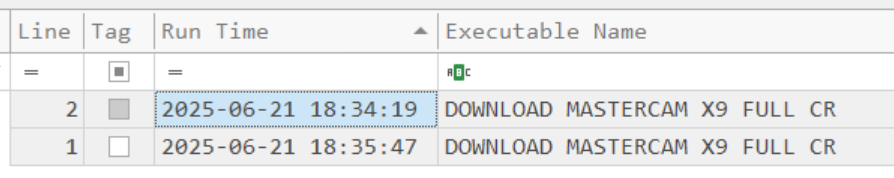
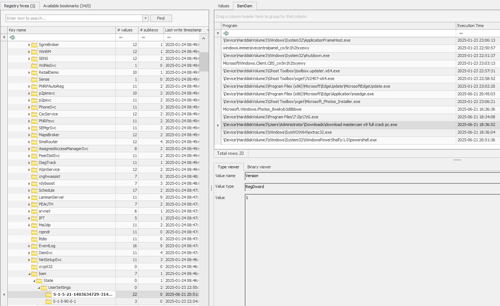
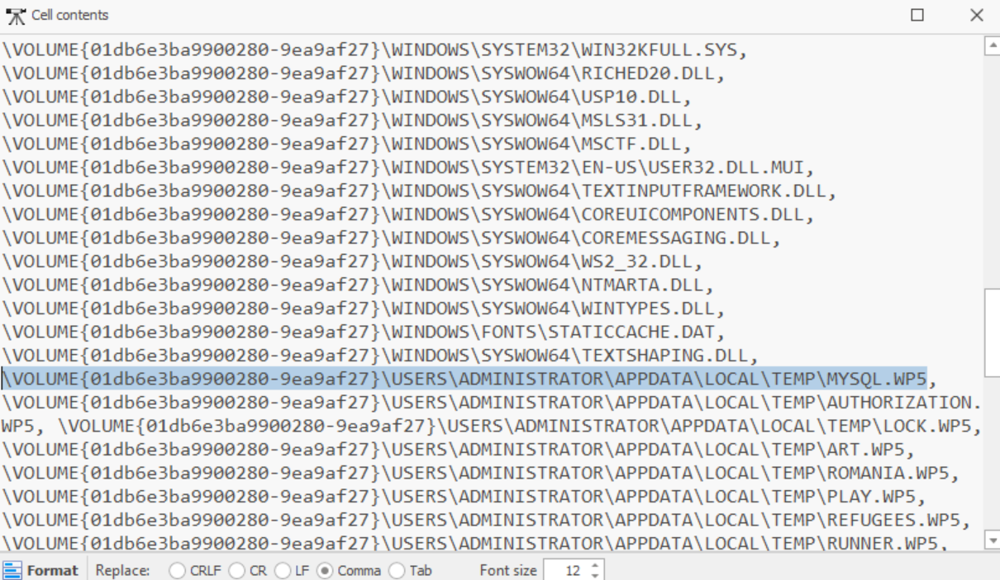
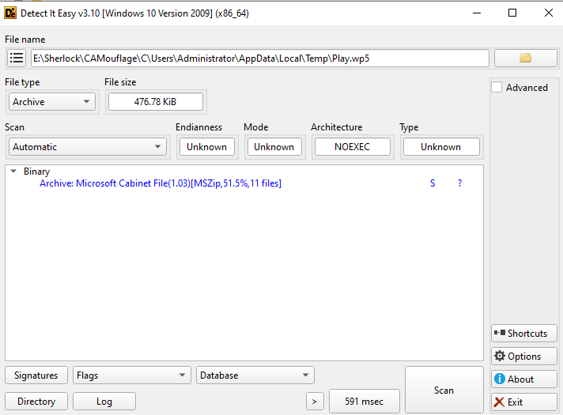
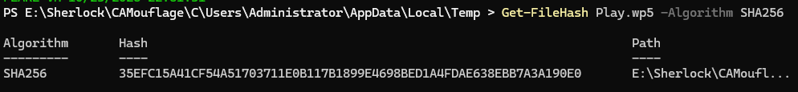
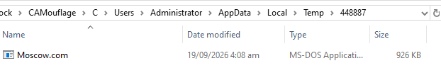
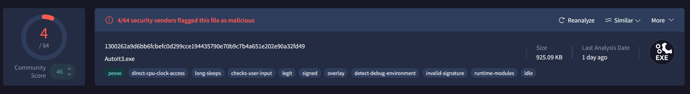
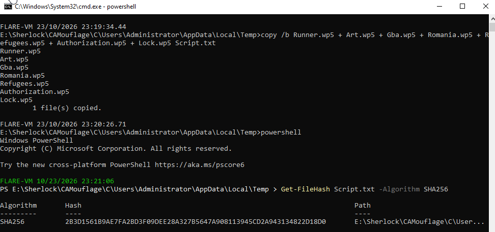
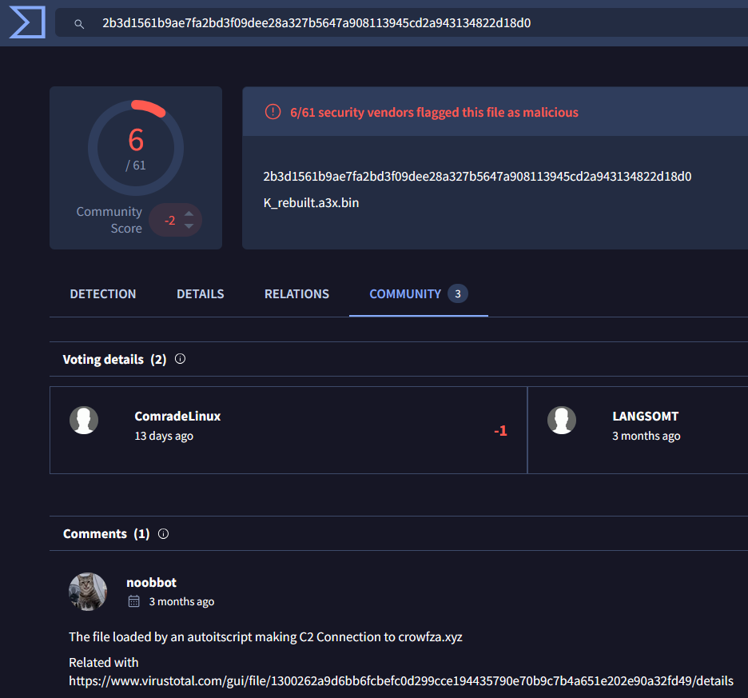

# CAMouflage

| Investigation Details | |
| :--- | :--- |
| **Category** | *DFIR* |
| **Difficulty** | *Easy* |
| **Solve Date** | *09/20/2026* |

---

## Scenario Overview

> A newly launched campaign has been detected targeting multiple users utilizing cracked applications. We received an alert indicating unusual behavior from one of our user's laptops and performed an initial triage. Your task is to conduct a deep dive investigation to determine the root cause and extent of the incident.

---

## Task 1
**Based on forensic artifacts, at what precise timestamp did the user first execute the Cracked App installer?**

I checked the Prefetch folder of the endpoint drive and found a `.pf` file starting with `DOWNLOAD MASTERCAM X9 FULL CR`. The name is truncated, as Prefetch does with long executable names, but it fits the cracked-application theme of the scenario, so I assumed it was the installer. I parsed it with PECmd, which lists every recorded run time. The earliest one is the first execution.

**Answer:** `2025-06-21 18:34:19`

---

## Task 2
**When did the installer process terminate?**

I checked every artifact I could think of, especially the EVTX files, and thought I had hit a dead end. I then went through each hive in `System32\config` and found the answer in the `SYSTEM` hive. Its BAM (Background Activity Moderator) key contained an entry for `download mastercam x9 full crack pc.exe` under `\Users\Administrator\Downloads`, with the last execution time shown below.

**Answer:** `2025-06-21 18:36:52`

---

## Task 3
**What was the first file dropped by the malware post-installation?**

Going back to PECmd, the parsed Prefetch entry also lists every file the installer loaded. Scrolling to the `AppData\Local\Temp` paths, the first one in the list is `MYSQL.WP5`, followed by `AUTHORIZATION.WP5`, `LOCK.WP5`, `ART.WP5`, `ROMANIA.WP5`, `PLAY.WP5`, `REFUGEES.WP5`, and `RUNNER.WP5`.

**Answer:** `Mysql.wp5`

---

## Task 4
**What is the SHA-256 hash of the .cab archive extracted during the execution?**

I went to the Temp directory where the dropped files live and checked the file type of each one with Detect It Easy (DIE). `Play.wp5` turned out to be a Microsoft Cabinet file despite its extension. I then hashed it with `Get-FileHash`.

**Answer:** `35efc15a41cf54a51703711e0b117b1899e4698bed1a4fdae638ebb7a3a190e0`

---

## Task 5
**What command did the malware use to extract content files from that .cab file?**

The first dropped file, `Mysql.wp5`, contains an obfuscated batch script. After decoding it manually, I found the command it uses to unpack the cabinet.

**Answer:** `extrac32 /Y Play.wp5 *.*`

---

## Task 6
**During execution, the malware performed AV/EDR checks. How many security product-related strings did it search for in memory or processes?**

Decoding the rest of `Mysql.wp5`, I found this line:

`tasklist | findstr /I "opssvc wrsa avgui avguix msmpeng mbam hitmanpro"`

That is 7 strings, but `avgui` and `avguix` both belong to AVG, so they count as 1 since the question asks for unique products. That leaves 6 security products.

**Answer:** `6`

---

## Task 7
**After the batch file was executed, what was the name of the process that ran?**

Pivoting back to Task 1, besides the installer's Prefetch file I also found `MOSCOW.pf`. It is suspicious since it is not a typical program name. Looking at the Temp folder, `Moscow.com` sits in the `448887` subfolder, so I entered the name as the answer and it was accepted.

**Answer:** `MOSCOW.COM`

---

## Task 8
**What is the original name for that process?**

I ran `Get-FileHash -Algorithm SHA256` on `Moscow.com` and searched the hash in VirusTotal. It revealed the original file name. The binary is a legitimate AutoIt interpreter that was renamed to blend in, so it isn't dangerous on its own, but the attacker used it for malicious purposes.

**Answer:** `AutoIt3.exe`

---

## Task 9
**What is the SHA-256 hash of the file loaded by the above identified process?**

The original AutoIt script loaded by `Moscow.com` is deleted from the disk, but its pieces remain in the Temp folder. The deobfuscated batch script shows how the malware reconstructs it:

`copy /b Runner.wp5 + Art.wp5 + Gba.wp5 + Romania.wp5 + Refugees.wp5 + Authorization.wp5 + Lock.wp5 K`

I ran the same concatenation in the same order from the command line (outputting to `Script.txt`) and hashed the result with `Get-FileHash`.

**Answer:** `2b3d1561b9ae7fa2bd3f09dee28a327b5647a908113945cd2a943134822d18d0`

---

## Task 10
**What is the C2 Domain name address contacted by the malware?**

I searched the hash from Task 9 in VirusTotal. The Community tab had a comment saying the file is loaded by an AutoIt script making a C2 connection, and it also links back to the `AutoIt3.exe` hash from Task 8, which confirms the chain.

**Answer:** `crowfza.xyz`

---

## Summary

| Area | Finding |
| :--- | :--- |
| Initial access | User ran a cracked-software installer (`download mastercam x9 full crack pc.exe`) from `\Users\Administrator\Downloads` |
| Execution | Installer first ran 2025-06-21 18:34:19 (Prefetch); BAM shows last activity at 18:36:52 |
| Payload delivery | Fragments with `.wp5` extensions dropped to `AppData\Local\Temp`, starting with `Mysql.wp5`, an obfuscated batch script |
| Staging | `extrac32 /Y Play.wp5 *.*` unpacks a cabinet file (SHA-256 `35efc15a41cf54a51703711e0b117b1899e4698bed1a4fdae638ebb7a3a190e0`) |
| Defense evasion | `tasklist \| findstr` checks for 6 unique AV/EDR products; legitimate AutoIt interpreter renamed to `Moscow.com` |
| Loader | `Moscow.com` (`AutoIt3.exe`) runs a script rebuilt with `copy /b` from seven `.wp5` fragments, SHA-256 `2b3d1561b9ae7fa2bd3f09dee28a327b5647a908113945cd2a943134822d18d0` |
| Infrastructure | C2 domain `crowfza.xyz` |
| MITRE ATT&CK mapping | T1204.002 (User Execution: Malicious File), T1059.003 (Windows Command Shell), T1027 (Obfuscated Files or Information), T1140 (Deobfuscate/Decode Files), T1036 (Masquerading), T1518.001 (Security Software Discovery), T1071 (Application Layer Protocol) |