# KitsuneHook
 
  

| Investigation Details | |
| :--- | :--- |
| **Category** | *Threat Intelligence* |
| **Difficulty** | *Easy* |
| **Solve Date** | *08/05/2026* |

---
 
## Scenario Overview
 
> You're a Threat Intelligence Analyst with a new assignment: all you know is that Winnti is behind this mess. Your organization has detected suspicious activity targeting manufacturing and energy companies, and the SOC needs answers fast.
 
## Sources Used

- The Hacker News: [Winnti (APT41) Targets Japanese Firms in RevivalStone Campaign](https://thehackernews.com/2025/02/winnti-apt41-targets-japanese-firms-in.html)
- ETDA Threat Group Cards: [APT 41](https://apt.etda.or.th/cgi-bin/showcard.cgi?g=APT%2041)
- MITRE ATT&CK: [APT41 (G0044)](https://attack.mitre.org/groups/G0044/)
- Securonix: [Threat Labs Monthly Intelligence Insights, March 2025](https://www.securonix.com/blog/securonix-threat-labs-monthly-intelligence-insights-march-2025/)
- Sangfor: [Behinder v3.0 Analysis](https://www.sangfor.com/blog/cybersecurity/behinder-v30-analysis)
- LAC Co., Ltd.: [LAC WATCH Report on the Winnti RevivalStone Campaign](https://www.lac.co.jp/lacwatch/report/20250213_004283.html)
- Cybereason: [Operation CuckooBees: A Winnti Malware Arsenal Deep Dive](https://www.cybereason.com/blog/operation-cuckoobees-a-winnti-malware-arsenal-deep-dive)

---
 
## Task 1
**What is the primary APT designation number used to track this state-sponsored threat actor that has been active since at least 2012**
 
Starting from the only lead in the scenario, Winnti, I checked the ETDA threat actor card for Winnti Group. Its alias list shows the group overlaps with several other clusters, and the one carrying an APT number is APT 41. MITRE's G0044 entry tracks the same activity under that designation, so this is the primary APT designation the question is after.
 
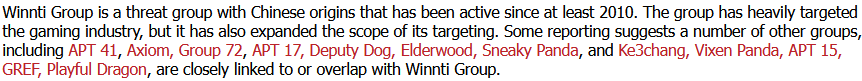
 
**Answer:** `APT41`
 
---

## Task 2
**This group is tracked under multiple names by different security vendors. Provide the alternative name used by Symantec.**

Symantec doesn't treat APT41 as a single actor. Their reporting splits it into two distinct actors, Grayfly and Blackfly. Since Winnti is the side tied to the Winnti malware and gaming-industry targeting, Blackfly is the alternative name for this group.

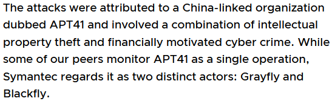

**Answer:** `Blackfly`

---

## Task 3
**What is the name of the campaign that specifically targeted organizations in the manufacturing, materials, and energy sectors?**

I searched for Winnti's known campaigns, and the key campaigns list had RevivalStone (2024-2025), which targeted Japanese manufacturing, materials, and energy organizations. The Hacker News and LAC reporting confirm this, and it matches the sectors in the scenario.

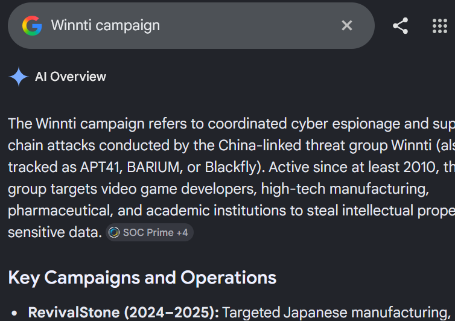

**Answer:** `RevivalStone`

---

## Task 4
**Internal documents from a security contractor, revealing a Linux controller for the malware, were leaked. What is the common name for this leak?**

The Hacker News article on LAC's findings states that the Linux controller found in the RevivalStone campaign was also included in a leak from the previous year. The leak is named I-Soon (also known as Anxun), after the Chinese security contractor whose internal documents were exposed.

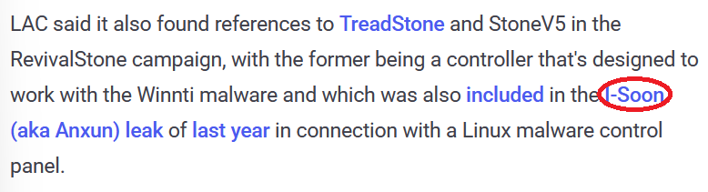

**Answer:** `I-Soon`

---

## Task 5
**Researchers discovered references to a Linux-based command and control infrastructure component with a geology-themed codename. What is the name of this control panel specifically engineered to manage the malware ecosystem?**

Same passage as the previous task. LAC found references to TreadStone and StoneV5 in the RevivalStone campaign. TreadStone is the controller designed to work with the Winnti malware, which also appeared in the I-Soon leak as a Linux malware control panel. The "Stone" in the name is the geology-themed codename the question hints at.

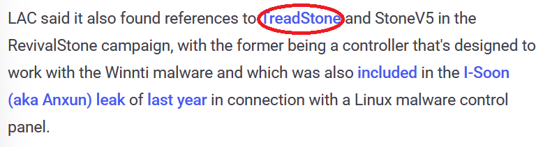

**Answer:** `TreadStone`

---

## Task 6
**What version designation was found in the samples that indicates the latest iteration of this malware?**

Continuing with the LAC researchers' comments, they speculate that if TreadStone carries the same meaning as the Winnti malware, then StoneV5 could mean Version 5. That makes it possible that the malware used in the attack is Winnti v5.0. It is only an inference by the researchers, but it is the version designation the question asks for.

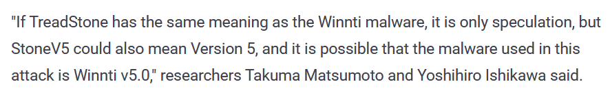

**Answer:** `Winnti v5.0`

---

## Task 7
**What type of vulnerability was exploited in the system to gain initial access during the campaign from task 3?**

LAC documented the latest RevivalStone attack chain as starting with an SQL injection vulnerability in an unspecified enterprise resource planning (ERP) system. That foothold was then used to drop web shells and deliver the improved Winnti malware, with reconnaissance and credential collection for lateral movement in between.

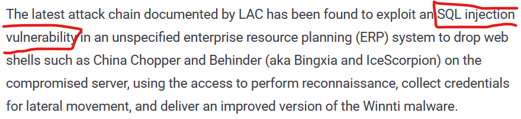

**Answer:** `SQL Injection`

---

## Task 8
**The adversaries deployed multiple web shells including "China Chopper" and "Behinder". What is the third web shell name mentioned?**

The Hacker News snippet only names China Chopper and Behinder, but the summary of the RevivalStone campaign below lists a third one: the web shells deployed after the SQL injection are China Chopper, Behinder, and the sqlmap file uploader.

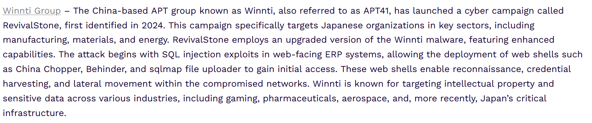

**Answer:** `sqlmap file uploader`

---

## Task 9
**Behinder (also called Bingxia) uses a hardcoded encryption key consisting of the first 16 characters of the MD5 hash of what specific word?**

Sangfor's Behinder v3.0 analysis explains that this version drops the dynamic key agreement in favor of a pre-shared key. The default key is the 16-character MD5 of the developer ID value, which is `rebeyond` (key `e45e329feb5d925b`). Side note: the blog's key format line shows `md5("admin")[0:16]`, but the actual default key value in the same passage is derived from the developer ID, so `rebeyond` is the word. Communication uses AES128, or XOR if the server's OpenSSL is not available.

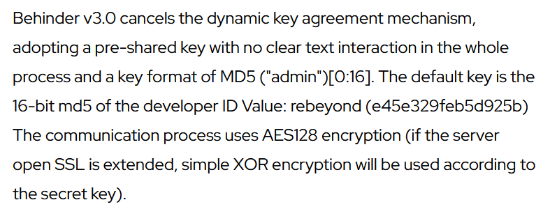

**Answer:** `rebeyond`

---

## Task 10
**Which malware uses Microsoft Graph API to fetch commands from email messages for file management, and proxy operations?**

Going through the malware list in the reporting, one entry stood out because of the Microsoft Graph API use: CUNNINGPIGEON, a backdoor that fetches commands (file and process management, and a custom proxy) from mail messages. Using email as the C2 channel lets the traffic blend in with legitimate Microsoft cloud traffic.

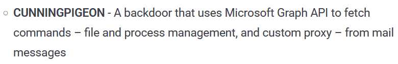

**Answer:** `CUNNINGPIGEON`

---

## Task 11
**In the previously mentioned campaign, a loader component drops a Remote Access Trojan (RAT), which then installs a kernel-level rootkit. Identify both the LOADER and the rootkit.**

LAC's infection flow diagram labels each stage. The Winnti Loader is PRIVATELOG, which decrypts and loads the encrypted Winnti payload and then loads the Winnti RAT (DEPLOYLOG). The RAT drops and starts the rootkit installer (`amonitor.sys`, run through the AmdK8 service), which finally deploys the kernel-level Winnti Rootkit, WINNKIT.

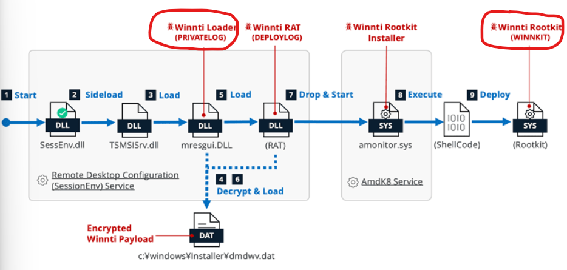

**Answer:** `PRIVATELOG_WINNKIT`

---

## Task 12
**Which Windows system service is commonly abused for DLL side-loading in this campaign using TSMSISrv.DLL?**

In the same diagram, the chain starts with `SessEnv.dll` sideloading `TSMSISrv.dll`. The diagram marks the host of that first stage as the Remote Desktop Configuration (SessionEnv) service, so SessionEnv is the legitimate Windows service being abused to run the malicious DLL.

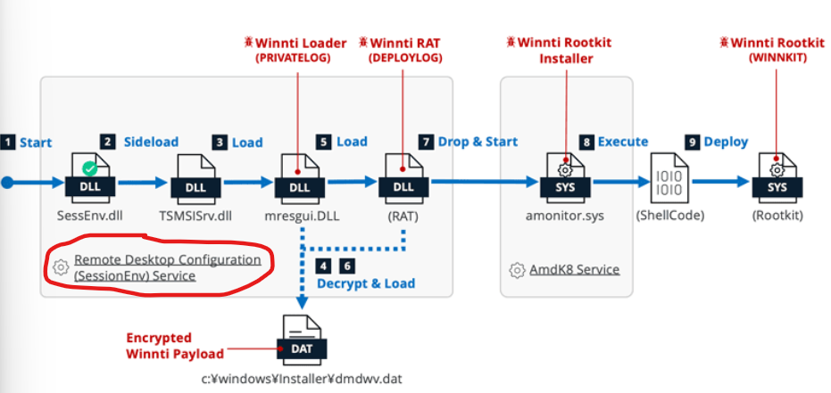

**Answer:** `SessionEnv`

---

## Task 13
**What AES encryption mode is used in the malware DAT file decryption process?**

LAC's overview of the DAT file decryption (Figure 13) shows the AES decryption block labeled OFB-Mode. The text confirms it: the notable parts are the repeated SHA256 hash calculations on key A, which look like a deliberate analysis-resistance measure, and OFB (Output Feedback) as the AES decryption mode. ChaCha20 stages then decrypt the final payloads.

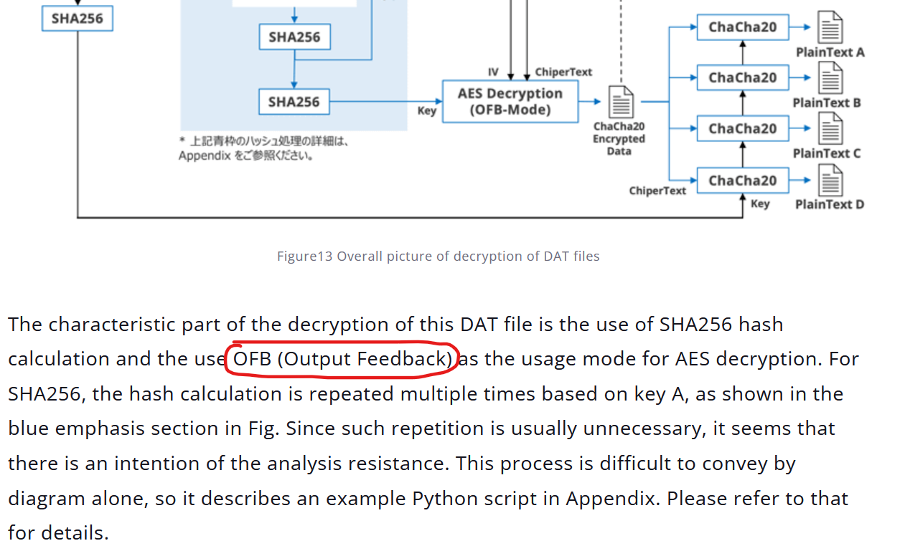

**Answer:** `Output Feedback`

---

## Task 14
**Two samples of DLL file prntvpt.dll from the campaign show compilation timestamps of May 12, 2021 and August 17, 2021. Identify the major APT campaign that was active during this exact timeframe in 2021.**

This one needed pivoting through the last source in the list, Cybereason's deep dive into the Winnti malware arsenal. The title itself ties the Winnti toolset to Operation CuckooBees, a long-running campaign of Winnti intellectual property theft that was active throughout 2021, which lines up with the compilation timestamps of the two `prntvpt.dll` samples.

**Answer:** `Operation CuckooBees`

---

## Task 15
**The Winnti_Rootkit YARA rule developed by LAC Co., Ltd. contains some detection strings. Two of these strings reference Windows kernel device objects using specific path formats. Identify the Windows device object path related to Sound function in hardware level that the rootkit interacts with.**

Cybereason's write-up describes how DEPLOYLOG sets up communication with the soon-to-be-deployed rootkit. It first tries to get a handle to the Beep device object (`\\?\GLOBALROOT\Device\Beep`), and if that fails, it falls back to `\\?\GLOBALROOT\Device\Null`. Beep is the kernel device tied to the PC speaker, hence the "sound function at hardware level" in the question. DEPLOYLOG then sends IOCTL `15E030` to the handle to test whether the rootkit is already deployed and running.

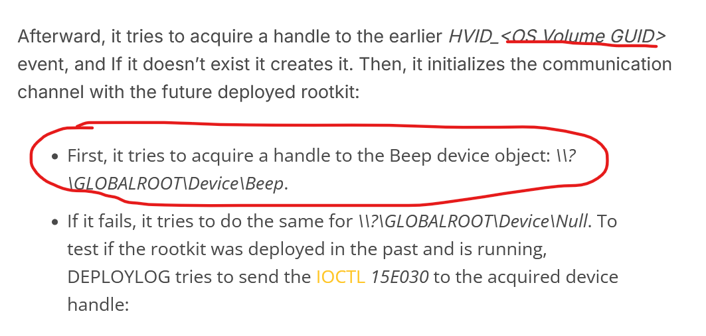

**Answer:** `\\Device\\Beep`

---

## Summary

| Area | Finding |
| :--- | :--- |
| Actor identity | Winnti Group, tracked as APT41 (Symantec splits it into Grayfly and Blackfly) |
| Campaign | RevivalStone (2024-2025), targeting Japanese manufacturing, materials, and energy organizations |
| Initial access | SQL injection in an unspecified ERP system |
| Web shells | China Chopper, Behinder (default key from MD5 of `rebeyond`), sqlmap file uploader |
| Infrastructure | Linux controller TreadStone / StoneV5 (Winnti v5.0), exposed in the I-Soon (Anxun) leak |
| Execution chain | `SessEnv.dll` sideloaded through the SessionEnv service, `TSMSISrv.dll`, PRIVATELOG loader, DEPLOYLOG RAT, `amonitor.sys` installer, WINNKIT rootkit |
| Payload protection | DAT file decrypted with repeated SHA256, AES in OFB mode, then ChaCha20 |
| Other tooling | CUNNINGPIGEON backdoor using Microsoft Graph API with email-based C2 |
| Related campaign | Operation CuckooBees (2021 `prntvpt.dll` samples) |
| Rootkit comms | Handle to `\\?\GLOBALROOT\Device\Beep` (fallback `Device\Null`), IOCTL `15E030` |
| MITRE ATT&CK mapping | T1190 (Exploit Public-Facing Application), T1505.003 (Server Software Component: Web Shell), T1574.002 (DLL Side-Loading), T1014 (Rootkit), T1027 (Obfuscated Files or Information), T1071.003 (Application Layer Protocol: Mail Protocols) |